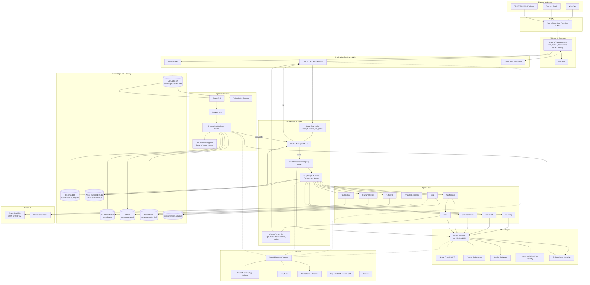

# 01 — End-to-End Architecture

## 1. Logical Layers

| # | Layer | Purpose | Key Azure services |
|---|---|---|---|
| 1 | Experience | Web, Teams, Slack, mobile, REST/SDK, MCP clients | Static Web Apps, Teams bot, SDKs |
| 2 | Edge | Global routing, WAF, DDoS, TLS | Azure Front Door Premium, WAF, DDoS Protection |
| 3 | API & AI Gateway | AuthN, quotas, token limits, tenant routing, model load balancing | Azure API Management (Premium v2), Entra ID |
| 4 | Application | Chat API, query service, ingestion API, admin API | AKS (FastAPI), Dapr sidecars |
| 5 | Orchestration | Guardrails, cache probe, router, LangGraph agent runtime | AKS, Azure Managed Redis |
| 6 | Agents & Tools | 12 specialized agents, MCP tool servers | AKS, APIM (MCP), Logic Apps connectors |
| 7 | Knowledge | Search index, graph, SQL, documents, memory | Azure AI Search, Neo4j, PostgreSQL, Cosmos DB, ADLS Gen2 |
| 8 | Model | LLM, embeddings, rerankers, OCR, speech | Azure OpenAI / Foundry Models, Document Intelligence, Speech, GPU node pools |
| 9 | Ingestion | Event-driven document processing | Event Grid, Service Bus, AKS workers + KEDA, Defender for Storage |
| 10 | Platform | Observability, security, governance, CI/CD | Azure Monitor, Langfuse, Grafana, Key Vault, Purview, GitHub Actions |

## 2. End-to-End Architecture Diagram

## 3. Request Lifecycle (summary)

1. **Edge** — Front Door terminates TLS, applies WAF/bot rules, routes to the nearest healthy region.
2. **Gateway** — APIM validates the Entra JWT, resolves `tenant_id`, enforces per-tenant RPM/TPM quotas, attaches `x-correlation-id`.
3. **Input guardrails** — Prompt Shields (jailbreak / indirect injection), PII detection (Presidio), tenant policy checks. Typical 15–40 ms.
4. **Cache probe** — L1 exact (session) → L2 semantic (session scope) → L3 organization → L4 global. Hit → stream cached answer (with fresh ACL re-check of cited docs).
5. **Router** — rules + fine-tuned classifier produce a calibrated probability per route A–H (see [03](03-query-routing.md)).
6. **Orchestrator** — LangGraph executes a single route, parallel top-2, or a Planning-Agent DAG.
7. **Generation** — Model Gateway selects tier/model by cost-latency-quality policy (see [10](10-model-strategy.md)).
8. **Output guardrails** — groundedness ≥ 0.80, citation coverage, content safety, PII redaction. Fail → regenerate / abstain / HITL.
9. **Response** — streamed via SSE; answer written to caches asynchronously; trace and cost recorded.

## 4. Multi-Tenancy Model

| Tier | Isolation | Search | Data stores | Typical tenant |
|---|---|---|---|---|
| Shared (Standard) | Logical | Shared index, mandatory `tenant_id` filter | Shared DB, RLS by `tenant_id` | SMB, < 1M docs |
| Dedicated (Premium) | Index / DB per tenant | Dedicated index on shared service | Dedicated schema/container | Mid-enterprise, 1–20M docs |
| Isolated (Sovereign) | Stamp per tenant | Dedicated AI Search service | Dedicated accounts, CMK, region pinned | Regulated / > 20M docs |

Tenancy is resolved once at the gateway and propagated as a signed claim; every downstream data-access call requires it (enforced in the data-access SDK, not by convention).

## 5. Deployment Stamps

The platform is deployed as **scale units ("stamps")**. A stamp = AKS cluster + AI Search service(s) + Redis + Cosmos/PG + Service Bus in one region, sized for ~2,500 concurrent users and ~25M documents. Global services (Front Door, Entra, global tenant catalog in Cosmos DB) route tenants to stamps. Scaling = adding stamps; see [15](15-azure-deployment.md) and [16](16-scalability-performance.md).
