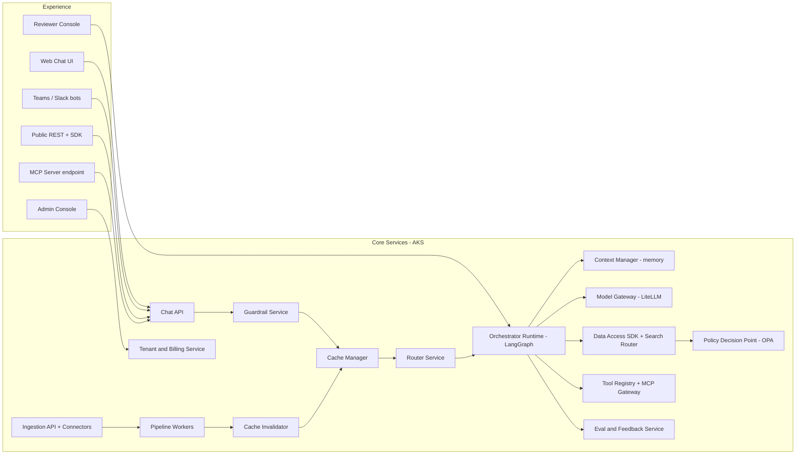

# 02 — Component Architecture

## 1. Component Map

## 2. Component Catalog

| # | Component | Responsibility | Tech | Scales by | Key dependencies | SLO |
|---|---|---|---|---|---|---|
| S1 | Chat API | Session handling, SSE streaming, conversation CRUD, feedback capture | FastAPI, uvicorn, SSE | HPA (in-flight requests) | APIM, Cosmos, S2–S5 | 99.95%, p95 overhead < 50 ms |
| S2 | Guardrail Service | Prompt Shields, PII detection/redaction, content safety (in/out), tenant policy | Azure AI Content Safety, Presidio | HPA CPU | Content Safety | p95 < 60 ms |
| S3 | Cache Manager | L1–L6 lookup/write, entity guard, ACL re-check | Python lib + Redis | Embedded in S1/S5 | Redis, embedding svc | p95 < 25 ms |
| S4 | Router Service | L0 rules, L1 classifier, confidence/risk scoring, clarifications | ONNX Runtime, FastAPI | HPA CPU | Model registry | p95 < 80 ms |
| S5 | Orchestrator Runtime | LangGraph graphs for all 12 agents, budgets, fallback, HITL interrupts | LangGraph, Pydantic | HPA (queue/in-flight) | S6–S10, Redis/Cosmos checkpointer | per-route SLOs |
| S6 | Context Manager | Memory read/write, summarization triggers, token budgeting | Python lib | with S5 | Redis, Cosmos, AI Search | p95 < 40 ms |
| S7 | Model Gateway | Provider abstraction, policy-based model routing, retries/fallback, cost metering | LiteLLM + custom policy, APIM AI gateway | HPA | AOAI, Foundry, Vertex, vLLM | 99.99% routing availability |
| S8 | Data Access SDK + Search Router | Tenant/ACL enforcement, tenant→index/DB mapping, RLS session vars | Python lib | — | PG, AI Search, Neo4j, Cosmos | — |
| S9 | Policy Decision Point | RBAC/ABAC decisions | OPA (Rego) sidecar | per pod | Policy bundles (Git) | p99 < 5 ms |
| S10 | Tool Registry + MCP Gateway | Tool manifests, entitlement filtering, MCP server hosting, rate limits | APIM (MCP), FastMCP servers | HPA | External APIs | per tool |
| S11 | Ingestion API + Connectors | Upload, SAS issuance, connector sync (SharePoint, OneDrive, S3, Confluence, email, SFTP) | FastAPI, Graph delta, Logic Apps | HPA | ADLS, Cosmos | p95 upload ack < 300 ms |
| S12 | Pipeline Workers | Stage workers: validate, extract, chunk, classify, embed, index | Python, Temporal / Durable Functions | KEDA (queue) | DI, Speech, VI, embeddings, AI Search, Neo4j | freshness p95 < 5 min |
| S13 | Cache Invalidator | Consume doc/ACL/version events → purge dependent keys | Python consumer | KEDA | Service Bus, Redis | < 30 s propagation |
| S14 | Tenant & Billing Service | Tenant lifecycle, stamp placement, quotas, budgets, usage aggregation | FastAPI, PG | HPA | Cosmos catalog, PG | 99.9% |
| S15 | Eval & Feedback Service | Online scores, offline eval runs, golden sets, router training data | Python, Langfuse, ADX | jobs | Langfuse, ADX | — |

## 3. Cross-Cutting Libraries

| Library | Purpose |
|---|---|
| `advance-rag-core` | Tenant context, correlation ids, error model, settings |
| `advance-rag-telemetry` | OTel setup, GenAI semantic conventions, redaction |
| `advance-rag-data` | Data Access SDK (mandatory for all data calls) |
| `advance-rag-llm` | Model Gateway client, structured output helpers |
| `advance-rag-guard` | Guardrail client, PII utilities |
| `advance-rag-agents` | Base agent node, budgets, typed results |

## 4. Interfaces

| Interface | Style | Notes |
|---|---|---|
| Public chat | REST + SSE (`POST /v1/chat`, `GET /v1/conversations/{id}`) | OpenAPI 3.1, versioned |
| Public ingestion | REST (`POST /v1/documents`, SAS upload, `GET /v1/documents/{id}/status`) | Webhooks on completion |
| Agent-to-tool | MCP (streamable HTTP) via APIM | OAuth OBO |
| Agent-to-agent (external) | A2A protocol (roadmap) | |
| Internal async | Service Bus topics: `doc.changed`, `acl.changed`, `cache.invalidate`, `hitl.task`, `usage.event` | CloudEvents schema |
| Admin | REST + Admin Console | PIM-gated for platform scope |
