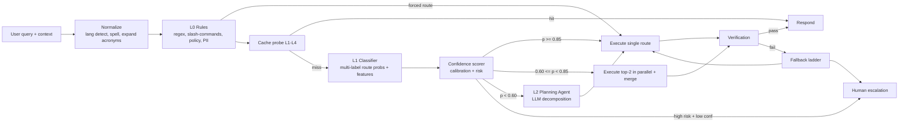
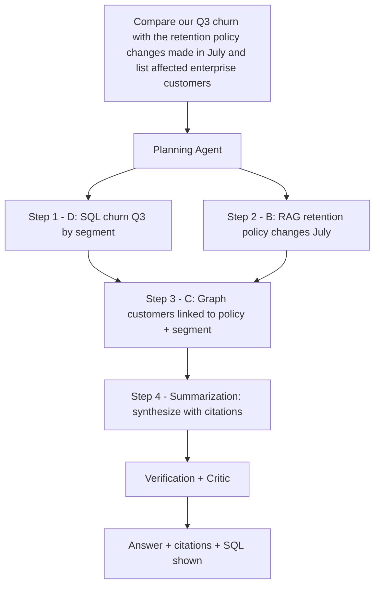

# 03 — Query Routing Intelligence

The **Intent Classification & Query Router** decides the cheapest execution path that can produce a correct, grounded, authorized answer. It is a hybrid of deterministic rules, a fine-tuned classifier and (only when needed) an LLM planner.

## 1. Route Catalog

| Code | Route | Chosen when | Typical latency | Relative cost |
|---|---|---|---|---|
| G | Cached answer | Exact or semantic match above threshold, ACL-compatible, not stale | 2–50 ms | ~0 |
| A | Direct LLM | General knowledge, rewriting, coding help, no tenant data needed, no recency need | 0.6–1.5 s | 1× |
| B | Vector / hybrid search (RAG) | Questions about tenant documents, policies, procedures | 1.2–2.5 s | 2× |
| C | Knowledge graph | Multi-hop relationships, "who/what is connected to", lineage, org/ownership | 1.5–3 s | 2–3× |
| D | SQL database | Aggregations, metrics, filters over structured data ("how many", "top 10", "trend") | 1.5–3.5 s | 2–3× |
| E | External API / tools | Live data (ticket status, stock, weather), actions (create, update, send) | 1–4 s | 2–4× |
| F | Specialized agents / workflow | Multi-step tasks, comparisons across sources, report generation | 5–60 s (async for long) | 5–20× |
| H | Human escalation | Low confidence + high risk, policy-required approval, repeated verification failure | async | human |

## 2. Router Pipeline

### 2.1 L0 — Deterministic rules (≈1 ms)

- Explicit commands (`/sql`, `/search`, `/agent`) and UI context (user is inside a dataset view → bias D).
- Tenant policy: e.g., "legal" workspace forbids route A for factual questions (must be grounded).
- Guardrail outcomes: jailbreak detected → block; PHI in query + non-HIPAA model → force compliant model pool.
- Action verbs with side effects (`delete`, `send`, `approve`, `pay`) → E with mandatory confirmation step.

### 2.2 L1 — Fine-tuned classifier (≈15–40 ms on CPU/GPU)

- **Model:** fine-tuned multilingual encoder (e.g., DeBERTa-v3 / multilingual-E5-base) with a multi-label sigmoid head over routes A–F + auxiliary heads: `needs_recency`, `needs_tenant_data`, `is_aggregation`, `is_multi_hop`, `has_side_effect`, `domain_risk`.
- **Features:** query embedding (re-used from cache probe — no extra cost), conversation-state features (previous route, active document filter), tenant catalog features (does tenant have SQL sources, graph, tools?), user role.
- **Training data:** 50k+ labeled queries bootstrapped by LLM labeling (frontier model + rubric), human-audited 10% sample; continuously enriched from production traces where verification passed/failed (see §8).
- **Serving:** ONNX Runtime on AKS CPU pool; batched; p99 < 40 ms.

### 2.3 L2 — LLM Planning (only for p < 0.60, ~8–15% of traffic)

A T1 model receives the query, available capabilities for the tenant (tool/data-source manifests) and the classifier's distribution, and returns a structured plan (JSON schema-validated): ordered steps, each with route, sub-query, dependencies, and expected output type.

## 3. Confidence Scoring

Final route confidence combines model probability, calibration and context signals:

$$
\text{conf}(r) = \sigma\Big(\frac{\text{logit}_r}{T}\Big)\cdot w_{\text{avail}}(r)\cdot w_{\text{hist}}(r) - \lambda \cdot \text{ambiguity}
$$

| Term | Meaning |
|---|---|
| $T$ | Temperature from calibration (fit on held-out set, target ECE < 0.03) |
| $w_{\text{avail}}$ | 0 if tenant lacks that capability (e.g., no SQL source), else 1 |
| $w_{\text{hist}}$ | Per-tenant prior from recent success rate of the route for similar queries (0.8–1.2) |
| ambiguity | Entropy of the route distribution, normalized to [0,1]; $\lambda = 0.15$ |

**Risk score** (0–1) from domain (medical, legal, financial, HR), side effects, and data sensitivity labels. Decision matrix:

| | Risk < 0.5 | Risk ≥ 0.5 |
|---|---|---|
| conf ≥ 0.85 | Execute single route | Execute single route + strict verification (groundedness ≥ 0.90) |
| 0.60–0.85 | Parallel top-2, merge | Parallel top-2 + strict verification; fail → HITL |
| < 0.60 | Planning Agent | Planning Agent; if plan confidence < 0.60 → clarifying question or HITL |

**Clarifying question** is preferred over HITL when ambiguity is the main driver (e.g., "Q3 numbers" without entity) — the router returns 1–3 disambiguation options in < 300 ms.

## 4. Fallback Strategy (ladder)

Each step is attempted only if the previous fails verification or errors/times out. Budgets prevent runaway loops.

| Step | Action | Trigger |
|---|---|---|
| 1 | Retry same route with query rewrite (HyDE / multi-query / step-back) | Retrieval recall low (top rerank score < 0.35) |
| 2 | Escalate to second-best route (e.g., B → C, D → B over data dictionary) | Empty / irrelevant results, SQL error after 2 repair attempts |
| 3 | Escalate model tier (T1 → T2) | Verification failed due to reasoning, not missing evidence |
| 4 | Planning Agent multi-source | Evidence partial across sources |
| 5 | Grounded abstention ("I couldn't find this in your documents…") + suggested sources | Evidence absent; risk < 0.5 |
| 6 | Human escalation | Risk ≥ 0.5, or user requests, or 2 verification failures |

Hard limits per request: max 3 fallback steps, max 8 LLM calls, max 30 s for synchronous routes (F routes switch to async job with progress streaming).

## 5. Multi-Step Reasoning Chain

For compound queries, the Planning Agent produces a DAG executed by LangGraph:

Rules:

- Independent steps run in parallel (`asyncio.gather` within LangGraph nodes).
- Each step output is typed (`TableResult`, `PassageSet`, `GraphPaths`, `ToolResult`) and stored in agent scratchpad memory.
- Re-planning is allowed once if a step fails; the plan diff is traced.
- Reasoning is **ReAct-style for tools**, **plan-and-execute for multi-source**, never unbounded loops.

## 6. Hallucination Prevention (defense in depth)

| Layer | Technique |
|---|---|
| Routing | Tenant-data questions are never sent to route A (`needs_tenant_data` head ≥ 0.5 blocks A) |
| Retrieval | Hybrid + rerank; minimum evidence threshold (rerank score ≥ 0.35 on ≥ 1 chunk) else abstain/fallback |
| Prompting | System prompt requires answering **only** from supplied context, mandatory `[doc:chunk]` citations, explicit "insufficient evidence" option |
| Decoding | Low temperature (0–0.2) for grounded routes; structured outputs (JSON schema) for SQL/tools |
| Verification | Claim extraction → per-claim NLI entailment against cited chunks; Azure AI Content Safety groundedness detection; citation coverage ≥ 90% of sentences |
| SQL | Results are computed by the DB, not the LLM; numbers in the answer are checked against the result set |
| Critic | Separate model family reviews high-risk answers (cross-model check reduces correlated errors) |
| Abstention | Below thresholds → abstain with the best partial evidence |
| Feedback | Thumbs-down + hallucination reports feed eval datasets and router retraining |

## 7. Router Output Contract

The router returns a `RoutingDecision` object (Pydantic):

| Field | Type | Notes |
|---|---|---|
| `routes` | list[{route, confidence}] | sorted, top-3 |
| `mode` | `single` \| `parallel` \| `plan` \| `clarify` \| `escalate` | |
| `risk` | float | 0–1 |
| `flags` | set | `needs_recency`, `has_side_effect`, `phi_present`, … |
| `model_tier_hint` | `T0` \| `T1` \| `T2` | consumed by Model Gateway |
| `rewritten_query` | str | normalized / coreference-resolved |
| `filters` | dict | extracted entities, date ranges, doc types |
| `explanation` | str | short, for traces and admin UI |

## 8. Continuous Improvement Loop

1. All routing decisions + verification outcomes + user feedback are logged to Langfuse and ADX.
2. Nightly job mines "wrong-route" signals: fallback triggered, route changed by fallback, thumbs-down, HITL overrides.
3. Weekly retrain of the L1 classifier; shadow-deployed for 48 h; promoted only if route accuracy +≥1 pt and no regression in P95 latency.
4. Per-tenant priors ($w_{\text{hist}}$) updated hourly.

**Targets:** route accuracy ≥ 93% (top-1), ≥ 98% (top-2); L2 planner usage ≤ 15%; HITL rate ≤ 0.5% of queries.

**Enhancements:** Uncertainty-Decomposed Router (A1), Safe Contextual Bandit Routing (A2) and Conformal Abstention Guard (A3) — see [22](22-novel-algorithms-and-features.md).
