# 04 — Agent Architecture

## 1. Topology

The agent layer is a **hierarchical supervisor** graph implemented in LangGraph. The Orchestrator Agent is the supervisor; worker agents are LangGraph sub-graphs exposed as nodes. Tools are exposed via **MCP servers** behind APIM so they are governed, rate-limited and audited centrally.

```mermaid
flowchart TB
    IN["Routing decision + query"] --> ORC["Orchestrator Agent<br/>supervisor"]
    ORC --> PLAN["Planning Agent"]
    PLAN --> ORC
    ORC --> RET["Retrieval Agent"]
    ORC --> RES["Research Agent"]
    ORC --> SQL["SQL Agent"]
    ORC --> KG["Knowledge Graph Agent"]
    ORC --> TOOL["Tool Calling Agent"]
    ORC --> SUM["Summarization Agent"]
    RES --> RET
    RES --> KG
    RES --> TOOL
    RET & SQL & KG & TOOL & RES --> SUM
    SUM --> VER["Verification Agent"]
    VER -- pass --> CRIT["Critic Agent<br/>high-risk only"]
    VER -- fail --> ORC
    CRIT -- approve --> OUT["Response"]
    CRIT -- revise --> SUM
    CRIT -- escalate --> HUM["Human Review Agent"]
    ORC -- policy / low confidence --> HUM
    HUM --> OUT

    DOC["Document Processing Agent<br/>ingestion plane, async"] -.-> IDX[("Indexes")]
```

**Execution model**

- State: a typed `AgentState` (Pydantic) checkpointed to Redis (hot) and Cosmos DB (durable) via LangGraph checkpointer — enables resume after pod failure and HITL pauses.
- Concurrency: independent nodes run in parallel; each node has a timeout and token budget.
- Every node emits an OTel span (`agent.name`, `agent.step`, `tokens.in/out`, `cost.usd`, `tenant.id`).
- Agents call models only through the Model Gateway and data only through the Data Access SDK (enforces tenant + ACL).

## 2. Shared Conventions

| Concern | Convention |
|---|---|
| Timeouts | Per-node default 8 s; retrieval 1.5 s; SQL 10 s; tools 5 s (configurable per tool) |
| Retries | Exponential backoff with jitter, max 2 for transient errors (429/5xx/timeouts) |
| Circuit breakers | Per dependency (model deployment, tool, DB); open after 50% errors over 20 calls / 30 s |
| Budgets | Per request: ≤ 8 LLM calls, ≤ 40k tokens, ≤ $0.05 default (tenant-configurable) |
| Idempotency | Tool calls with side effects carry idempotency keys; never auto-retried without key |
| Output | Typed results + `evidence[]` + `confidence` + `errors[]` |

## 3. Agent Specifications

### 3.1 Orchestrator Agent

| Attribute | Specification |
|---|---|
| Responsibilities | Executes the routing decision; dispatches to worker agents; manages parallelism, budgets, fallback ladder, streaming; assembles final response |
| Inputs | `RoutingDecision`, user query, user/tenant context (claims, ACL hash), conversation summary |
| Outputs | Final answer stream, citations, execution trace, cache-write instruction |
| Memory | Session memory (Redis), conversation summary, `AgentState` checkpoint |
| Failure handling | Fallback ladder (see [03 §4](03-query-routing.md)); budget exhaustion → partial answer with disclosure; dependency circuit open → alternate route |
| Tools | None directly (delegates); uses Model Gateway for final synthesis when Summarization is skipped |

### 3.2 Planning Agent

| Attribute | Specification |
|---|---|
| Responsibilities | Decompose complex/low-confidence queries into a DAG of typed steps; select routes per step; re-plan once on failure |
| Inputs | Query, router distribution, tenant capability manifest (data sources, tools, graph schemas), conversation summary |
| Outputs | `Plan{steps[{id, route, sub_query, depends_on, expected_type}], rationale}` (JSON-schema validated) |
| Memory | Agent memory: library of successful plan templates (vector-indexed) for few-shot retrieval |
| Failure handling | Invalid JSON → constrained-decoding retry; cyclic DAG → reject and re-plan; > 6 steps → collapse or async mode |
| Tools | Capability registry lookup, plan-template retrieval |

### 3.3 Retrieval Agent

| Attribute | Specification |
|---|---|
| Responsibilities | Query rewriting (multi-query, HyDE when sparse recall low), hybrid search with security filters, RRF fusion, reranking, parent-chunk expansion, context compression |
| Inputs | Sub-query, filters (tenant, ACL groups, doc types, dates), top-k, token budget |
| Outputs | `PassageSet{passages[{chunk_id, doc_id, text, score, page, url}], recall_signal}` |
| Memory | L5 embedding cache, L6 search-result cache; no conversational memory |
| Failure handling | Low top score → rewrite & retry once; search service throttled → secondary replica / region; empty → signal fallback |
| Tools | Azure AI Search (hybrid + semantic ranker), embedding service, cross-encoder reranker, compressor |

### 3.4 Research Agent

| Attribute | Specification |
|---|---|
| Responsibilities | Deep, iterative investigation across multiple sources (docs, graph, web/approved APIs); gap analysis; produces structured findings |
| Inputs | Research question, scope (sources allowed), depth/budget |
| Outputs | `Findings{claims[{text, evidence[], confidence}], open_questions[], sources[]}` |
| Memory | Scratchpad (Redis, TTL = job); long-running jobs checkpointed to Cosmos DB |
| Failure handling | Iteration cap (≤ 5 loops), novelty check (stop when new evidence < 10%), partial findings returned on timeout |
| Tools | Retrieval Agent, KG Agent, Tool Agent (approved web search / Bing grounding), Summarization Agent |

### 3.5 Verification Agent

| Attribute | Specification |
|---|---|
| Responsibilities | Claim extraction, per-claim entailment vs. cited evidence, citation validity, numeric consistency (SQL results), ACL re-check of cited docs |
| Inputs | Draft answer, evidence set, route, risk score |
| Outputs | `Verdict{groundedness, citation_coverage, unsupported_claims[], pass}` |
| Memory | Stateless; verdicts logged for eval datasets |
| Failure handling | Verifier unavailable → for risk < 0.5 serve with "unverified" flag, for risk ≥ 0.5 hold and escalate |
| Tools | NLI model (T0, local), Azure AI Content Safety groundedness detection, numeric checker |

### 3.6 Critic Agent

| Attribute | Specification |
|---|---|
| Responsibilities | Quality and policy review for high-risk or high-value answers: completeness, tone, policy compliance, bias, harmful advice; proposes revisions |
| Inputs | Draft answer, query, verdict, tenant policy pack |
| Outputs | `Critique{score 1-5, issues[], action: approve / revise / escalate}` |
| Memory | Tenant policy pack (org memory); critique history for prompt tuning |
| Failure handling | Max 1 revision cycle; disagreement persists → escalate to human |
| Tools | Model from a **different family** than the generator (e.g., generator GPT → critic Claude) |

### 3.7 SQL Agent

| Attribute | Specification |
|---|---|
| Responsibilities | NL→SQL over a governed semantic layer; schema linking; query validation; execution under user identity; result explanation |
| Inputs | Sub-query, data-source id, user identity (OBO token), semantic layer (metrics, dimensions, synonyms) |
| Outputs | `TableResult{sql, columns, rows (≤ 1,000), row_count, chart_hint}` |
| Memory | Agent memory: verified question→SQL pairs (vector-indexed few-shot); schema cache (Redis) |
| Failure handling | Static validation (sqlglot AST: SELECT-only, no DDL/DML, LIMIT enforced, cost estimate); DB error → repair loop ≤ 2; timeout → suggest narrower filter |
| Tools | Schema/semantic-layer service, read-only connection pool (RLS enforced), query cost estimator |

### 3.8 Knowledge Graph Agent

| Attribute | Specification |
|---|---|
| Responsibilities | Entity linking, NL→Cypher (templated first, generative second), multi-hop traversal, community-summary retrieval (GraphRAG global search) |
| Inputs | Sub-query, extracted entities, tenant graph id, ACL groups |
| Outputs | `GraphPaths{nodes[], edges[], paths[], community_summaries[], source_chunks[]}` |
| Memory | Entity alias cache (Redis), verified Cypher templates |
| Failure handling | Unknown entity → fuzzy match + clarification; query > 2 s → depth limit; empty → fallback to B |
| Tools | Neo4j (read-only role, `tenant_id` + ACL predicates injected), entity linker, Cypher validator |

### 3.9 Tool Calling Agent

| Attribute | Specification |
|---|---|
| Responsibilities | Select and invoke MCP/OpenAPI tools; argument extraction; confirmation for side-effecting actions; result normalization |
| Inputs | Sub-query, tool manifest filtered by user entitlements, user OBO token |
| Outputs | `ToolResult{tool, args, status, data, side_effect: bool}` |
| Memory | Session memory for multi-turn slot filling; tool-usage stats |
| Failure handling | Schema-validated args; 4xx → ask user for missing/invalid args; 5xx → retry ≤ 2 (idempotent only); side effects require explicit user confirmation or HITL per policy |
| Tools | MCP servers (ServiceNow, Salesforce, SAP, Graph API, Jira, custom), APIM as MCP gateway |

### 3.10 Document Processing Agent (ingestion plane)

| Attribute | Specification |
|---|---|
| Responsibilities | Orchestrates per-file pipeline: type detection, extraction strategy selection (layout vs. OCR vs. transcription), chunking strategy, classification, PII tagging, entity extraction for graph |
| Inputs | Blob event (uri, tenant, uploader, ACL), file metadata |
| Outputs | Chunks + embeddings + metadata to AI Search; entities/relations to Neo4j; registry status in Cosmos DB |
| Memory | Pipeline state in Cosmos DB (per-doc status machine); content-hash index for dedup |
| Failure handling | Per-stage retry with DLQ; poison files quarantined; partial success recorded per page; re-drive tooling |
| Tools | Document Intelligence, Speech, Video Indexer, Defender scan result, LLM classifier (T0), embedding service |

### 3.11 Summarization Agent

| Attribute | Specification |
|---|---|
| Responsibilities | Synthesizes final answer from evidence with citations; map-reduce summaries for long docs; conversation summarization for memory compression |
| Inputs | Query, typed evidence (passages, tables, graph paths, tool results), answer format, token budget |
| Outputs | Draft answer (markdown) with inline citations, or summary object |
| Memory | Conversation summary (writes), user preferences (tone, length, language) |
| Failure handling | Context overflow → compress evidence further; model error → tier fallback |
| Tools | Model Gateway (T1 default, T2 for complex synthesis) |

### 3.12 Human Review Agent

| Attribute | Specification |
|---|---|
| Responsibilities | Creates review tasks, routes to the right reviewer pool (domain, language, tenant), SLA tracking, captures decisions and feeds them back |
| Inputs | Escalation reason, query, draft, evidence, verdict, risk |
| Outputs | Review ticket; on completion: approved/edited answer delivered to user; labeled example to eval store |
| Memory | Review queue (Service Bus + Cosmos DB), reviewer decisions (long-term, for training) |
| Failure handling | SLA breach → auto-escalate to backup pool; user receives holding response with ticket id |
| Tools | Reviewer console (web), Teams adaptive cards, ServiceNow integration |

## 4. Agent State (LangGraph)

| Field | Purpose |
|---|---|
| `request` | query, tenant, user, ACL hash, locale |
| `routing` | `RoutingDecision` |
| `plan` | optional DAG |
| `scratchpad` | per-step typed outputs |
| `evidence` | merged, deduplicated evidence |
| `draft` / `verdict` / `critique` | generation artifacts |
| `budget` | tokens/calls/cost used vs. limit |
| `trace` | span ids, fallback history |

## 5. Agent Governance

- **Agent registry** (PostgreSQL): agent id, version, prompt version, allowed tools, allowed models, owner.
- **Prompt management** in Langfuse: versioned prompts, A/B labels, rollout per tenant.
- **Evaluation gate:** each agent version must pass offline evals (golden sets per tenant vertical) before promotion.
- **Least privilege:** each agent has its own workload identity; Tool/Data SDK enforces allow-lists.
