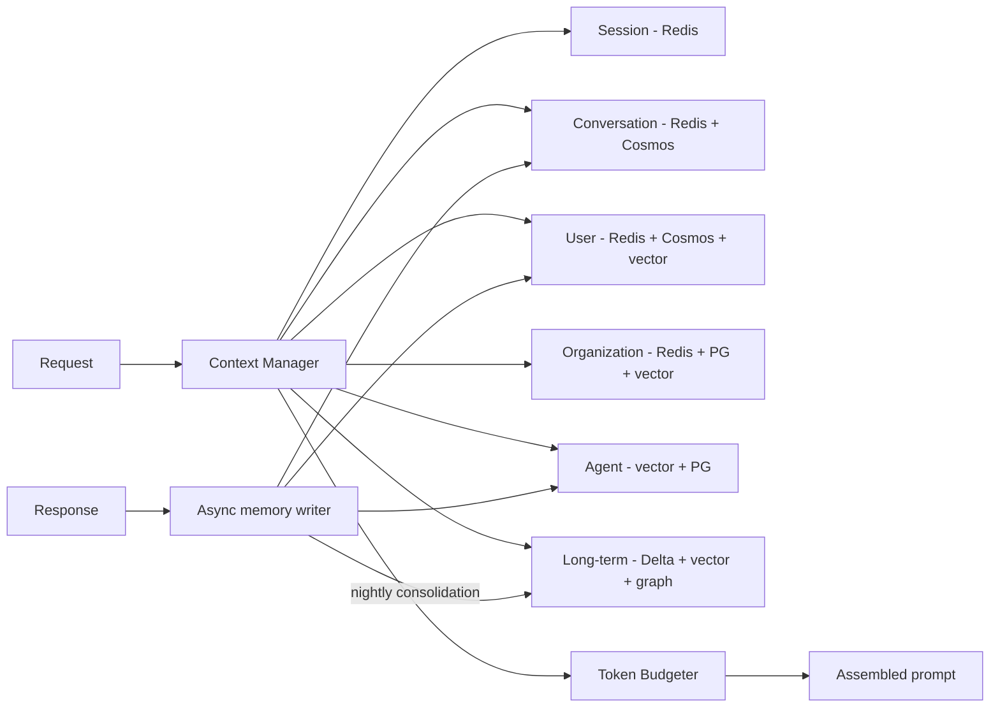

# 05 — Memory Architecture

## 1. Memory Tiers

| # | Tier | Scope | What it holds | Hot store | Durable store | Retention |
|---|---|---|---|---|---|---|
| 1 | Session memory | One live session (tab/device) | Working state: active filters, last route, pending tool slots, LangGraph checkpoint | Redis hash | — | TTL 30 min sliding |
| 2 | Conversation memory | One conversation thread | Turns, rolling summary, cited docs, key facts | Redis list (last 20 turns) | Cosmos DB `conversations` | 90 days default (tenant-configurable 0–7 yrs) |
| 3 | User memory | One user across conversations | Preferences (language, tone, verbosity), role, frequent topics, explicit "remember that…" facts | Redis hash (profile) | Cosmos DB `user_memory` + AI Search `memory` index | Until user deletes; reviewed annually; GDPR erasable |
| 4 | Organization memory | One tenant | Glossary/acronyms, policies, approved answers, semantic layer, entity aliases, tenant prompts | Redis (L3 cache, glossary) | PostgreSQL + AI Search `org_memory` index | Lifecycle of source content |
| 5 | Agent memory | One agent type (per tenant or global) | Successful plans, verified question→SQL/Cypher pairs, tool-usage stats, failure patterns | Redis (top-k templates) | AI Search `agent_memory` index + PostgreSQL | Versioned; pruned when schema changes |
| 6 | Long-term memory | Platform-wide knowledge about interactions | Episodic summaries, consolidated semantic facts, feedback-labeled examples | — | ADLS (Delta) + AI Search `ltm` index + Neo4j (fact graph) | Policy-driven (1–7 yrs), anonymized for global use |

## 2. Redis Usage

**Service:** Azure Managed Redis (Enterprise / Balanced tier, clustered, zone-redundant, active geo-replication across active regions). RediSearch + RedisJSON modules enabled.

| Key pattern | Type | Purpose | TTL |
|---|---|---|---|
| `sess:{tenant}:{session}` | Hash | Session working state | 30 min sliding |
| `ckpt:{tenant}:{thread}:{step}` | JSON | LangGraph checkpoint (hot) | 2 h |
| `conv:{tenant}:{conv}:turns` | List (capped 20) | Recent turns | 24 h, rehydrated from Cosmos |
| `conv:{tenant}:{conv}:summary` | String | Rolling summary | 24 h |
| `user:{tenant}:{user}:profile` | Hash | Preferences, role, locale | 7 d |
| `org:{tenant}:glossary` | Hash | Acronyms, synonyms | 24 h, event-invalidated |
| `agentmem:{agent}:{tenant}:tpl` | JSON + vector | Top plan/SQL templates | 24 h |
| `ratelimit:{tenant}:{user}` | Counter | Token-bucket rate limits | 1 min |

Rules: every key is tenant-prefixed; Redis is never the system of record (everything is rebuildable); `maxmemory-policy allkeys-lfu` for cache DBs, `volatile-ttl` for memory DB; separate Redis databases/clusters for **cache** vs **memory** to avoid eviction interference.

## 3. Vector & Semantic Memory

- **Vector memory:** user, org, agent and long-term memories are embedded (same 1024-d model as documents) and stored in dedicated AI Search indexes with `tenant_id`, `user_id`, `memory_type`, `importance`, `created_at`, `last_accessed`, `source_conv_id`.
- **Retrieval score** for memory items:

$$
\text{score} = 0.6\cdot\text{sim} + 0.2\cdot\text{importance} + 0.2\cdot e^{-\Delta t/\tau}
$$

with $\tau$ = 30 days for user memory, 180 days for org memory.

- **Semantic memory:** facts extracted from conversations ("User owns the EMEA pricing project", "Tenant fiscal year starts in April") are stored as subject–predicate–object triples in Neo4j and as text in the vector index. Contradicting facts supersede older ones (versioned, not deleted).
- **Write policy:** memory extraction runs asynchronously after the response (T0 model), only stores facts with importance ≥ 0.5, never stores secrets/PHI unless tenant policy allows and the store is HIPAA-scoped.

## 4. Retention Policy

| Data | Default | Configurable | Deletion mechanism |
|---|---|---|---|
| Session | 30 min idle | 5–120 min | TTL |
| Conversation turns | 90 days | 0 (no history) – 7 yrs | Cosmos TTL + legal-hold override |
| Conversation summaries | Same as turns | — | Cascade |
| User memory | Until deleted | Opt-out per user | Self-service UI + DSAR API (GDPR Art. 17) |
| Org memory | Lifecycle of source | — | Source-delete event cascade |
| Agent memory | Until invalidated | — | Schema-version change, quality decay |
| Long-term (anonymized) | 3 yrs | 1–7 yrs | Partition drop |
| Audit logs | 7 yrs (immutable) | Per regulation | WORM retention expiry |

Legal hold flags in Cosmos DB/ADLS override TTL deletion.

## 5. Memory Compression

1. **Rolling summarization:** when conversation exceeds 8 turns or 3,000 tokens, older turns are summarized (T0/T1) into a ≤ 400-token summary; last 4 turns are kept verbatim.
2. **Key-fact extraction:** entities, decisions, numbers and open tasks are extracted into a structured "facts" block that survives summarization.
3. **Hierarchical summaries:** conversation → weekly user digest → long-term episodic memory.
4. **Evidence de-duplication:** previously cited chunks are referenced by id instead of re-inserted unless needed.
5. **Consolidation job (nightly):** merges near-duplicate memories (cos ≥ 0.95), decays low-importance items, resolves contradictions.

## 6. Context Optimization

**Token budget** for a T1 model call with 16k effective budget (configurable per model):

| Segment | Budget |
|---|---|
| System + policy prompt | 800 |
| User/org memory (top-k) | 600 |
| Conversation summary + last turns | 1,500 |
| Evidence (compressed) | 4,000 (up to 8,000 for T2 synthesis) |
| Tool / SQL results | 1,500 |
| Reserved for output | 1,500 |

Techniques:

- **Prompt caching:** stable prefix (system + policy + org glossary) ordered first so provider prompt caching (Azure OpenAI / Anthropic) applies — 50–90% input cost reduction on the cached prefix.
- **Lost-in-the-middle mitigation:** highest-ranked evidence at the start and end of the evidence block.
- **Adaptive k:** retrieve fewer chunks when top scores are high and tightly clustered.
- **Contextual compression:** sentence-level extraction relative to the query (see [08](08-retrieval-architecture.md)).
- **Long-context models** are used only for whole-document tasks (contract review), not as a substitute for retrieval.
