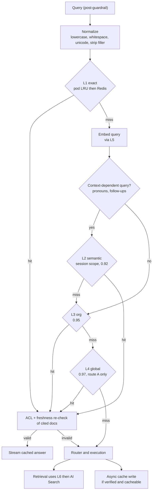
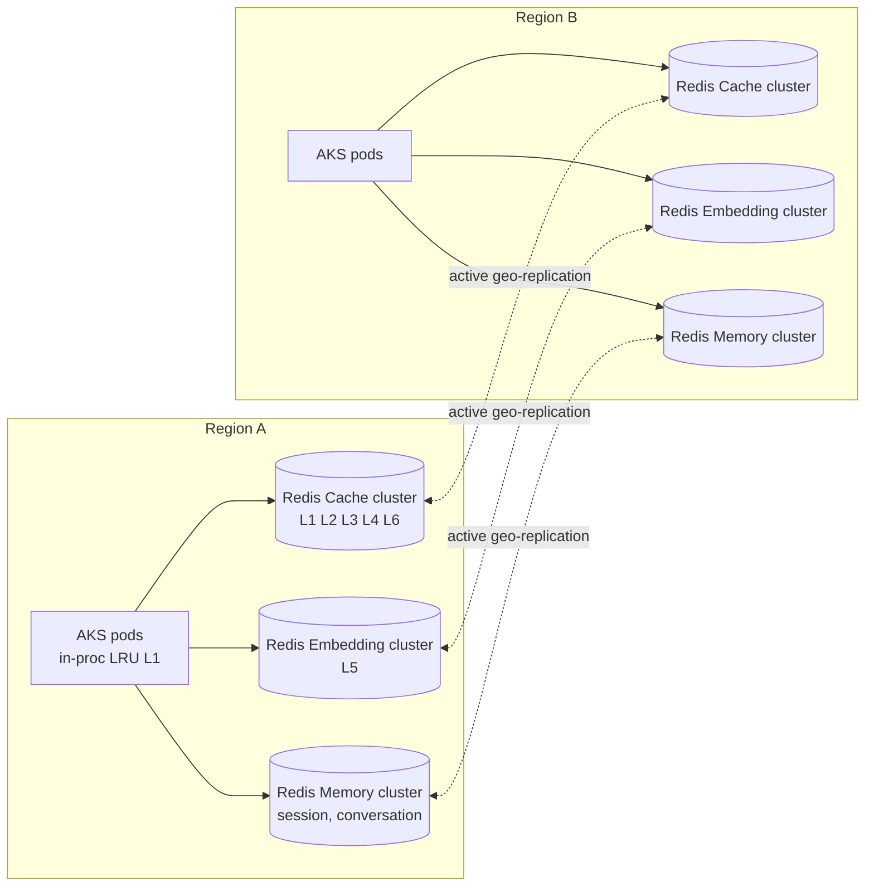

# 06 — Cache Architecture

Goal: serve repeated and semantically equivalent questions in **milliseconds**, eliminate redundant embedding/search work, and do so **without ever leaking data across tenants or permission boundaries**.

## 1. Cache Levels

| Level | Name | Scope | Key | Match | Value | TTL | Store |
|---|---|---|---|---|---|---|---|
| L1 | User session cache | user + session | `sha256(tenant, user, session, norm_query, prompt_ver)` | Exact (normalized) | Final answer + citations | 30 min | In-process LRU (pod) + Redis |
| L2 | Semantic cache | user / session scope | vector(query) + `tenant, acl_hash, conv_ctx_hash` | cos ≥ 0.92 | Final answer + citations + route | 4 h | Redis vector index |
| L3 | Organization cache | tenant + ACL group set | vector(query) + `tenant, acl_hash, corpus_ver` | cos ≥ 0.95 | Final answer + citations + doc ids | 24 h | Redis vector index |
| L4 | Global answer cache | all tenants, **public/non-tenant content only** (route A) | vector(query) + `model_ver, prompt_ver, locale` | cos ≥ 0.97 | Answer | 7 d | Redis vector index |
| L5 | Embedding cache | global (content-addressed) | `sha256(model_id, dims, normalized_text)` | Exact | int8 vector | 30 d (query), permanent for chunks via registry | Redis + ADLS (chunks) |
| L6 | Vector search cache | tenant + ACL | `sha256(tenant, acl_hash, index_ver, query_vec_hash, filters, k)` | Exact | Ranked chunk ids + scores | 15 min | Redis |

Additional platform caches: provider **prompt caching** (prefix), APIM response caching for idempotent tool GETs, schema/semantic-layer cache for SQL Agent.

## 2. Lookup Flow

Parallelization: L1 lookup and query embedding start concurrently; L2/L3/L4 vector lookups are issued in a single Redis pipeline and evaluated in priority order.

## 3. Cacheability Rules

An answer is written to cache only when **all** hold:

- Verification passed (groundedness ≥ 0.80) and no user thumbs-down.
- Route ∈ {A, B, C}; D only if the query has no relative-time phrases and the data source is marked `cacheable_minutes > 0`; E/F/H never (live/side-effecting/personalized).
- No PII/PHI in query or answer (unless the store is a tenant-scoped HIPAA cache with encryption).
- Not personalized (no user-memory facts used) for L3/L4.
- Answer derived only from documents visible to the **entire** ACL group set represented by `acl_hash`.

## 4. Security-Correct Keys

- `acl_hash = sha256(sorted(effective_group_ids) + clearance_level)` — users with identical effective permissions share L3 entries; users with different permissions never do.
- On a hit, cited `doc_id`s are re-checked against the user's current entitlements (bitmap check in Redis, ~1 ms). Any revoked doc → treat as miss.
- L4 holds answers to route-A (parametric knowledge) questions only; never contains tenant data. Tenants can opt out of L4.

## 5. Similarity Thresholds

| Level | Threshold | Rationale |
|---|---|---|
| L2 session | 0.92 | Same user/conversation context; paraphrase tolerance higher |
| L3 org | 0.95 | Cross-user; must avoid near-miss intents ("Q3 revenue" vs "Q4 revenue") |
| L4 global | 0.97 | Cross-tenant; very strict |

Safeguards against false hits:

- **Entity/number guard:** extracted entities, numbers, dates and negations must match exactly between cached and new query (fast NER + regex, < 2 ms).
- **Re-rank verification** for scores in the band [threshold, threshold + 0.02]: a cross-encoder equivalence check (~10 ms) confirms paraphrase.
- Thresholds are **calibrated per tenant** monthly from labeled pairs (target false-hit rate < 0.5%).

## 6. Cache Invalidation

| Trigger | Mechanism | Affected levels |
|---|---|---|
| Document added/updated/deleted | Ingestion emits `doc.changed{tenant, doc_id}` → Cache Invalidator looks up reverse index `dep:{tenant}:{doc_id} → {cache_keys}` → deletes | L1, L2, L3, L6 |
| ACL change on doc | `acl.changed` event → same reverse index + entitlement bitmap update | L1–L3, L6 |
| User group membership change | Entra change notification → user's `acl_hash` recomputed (old entries orphaned, expire by TTL) | L1–L3, L6 |
| Index re-build / alias swap | `corpus_ver` / `index_ver` bump → namespace change (old entries expire) | L3, L6 |
| Prompt / model version change | `prompt_ver` / `model_ver` in key → natural miss | L1–L4 |
| Embedding model change | `model_id` in key → natural miss; background re-embed | L5 |
| SQL data refresh | Source-level `data_ver` from CDC / ETL completion | Cached D answers |
| Manual / admin | Admin API purge by tenant / tag / doc | Any |

Versioned namespaces are preferred over bulk deletes (O(1) invalidation, no Redis `SCAN` storms).

## 7. Redis Architecture

- **Azure Managed Redis** (Balanced/Memory-optimized SKUs), clustered, zone-redundant, active-active geo-replication (CRDT-based conflict resolution).
- Three logical clusters: **Cache** (answers, search results), **Embedding** (L5; high memory, low CPU), **Memory** (session/conversation; low latency).
- Vector indexes via RediSearch HNSW (M=16, ef_runtime=64), int8 or float16 vectors, one index per stamp with `tenant_id` TAG prefilter; very large tenants get a dedicated index.
- Sizing (per stamp, illustrative): Cache 100–200 GB, Embedding 200–400 GB, Memory 50 GB.
- Client: connection pooling, pipelining, 50 ms timeout on cache paths — **a slow cache is treated as a miss**, never blocking the request.

## 8. Expected Speed Improvements

| Path | Latency (server) | vs. full path |
|---|---|---|
| Full RAG pipeline (miss) | 1.5–4 s | baseline |
| L1 exact hit | 1–5 ms | ~500–1000× |
| L2/L3 semantic hit (incl. query embedding) | 15–40 ms (embedding cached: 5–15 ms) | ~50–150× |
| L4 global hit | 20–50 ms | ~40–100× |
| L5 embedding hit | saves 20–80 ms per call | — |
| L6 search hit | saves 80–250 ms | — |

**Target hit rates (steady state):** L1 5–10%, L2+L3 20–30%, L4 5–10% → **35–50% overall answer-cache hit rate**; L5 > 60% for queries; L6 15–25%. Effect: P50 drops from ~1.8 s to ~0.9 s across all traffic and LLM spend drops 35–50%.

## 9. Cache Warming

- Nightly: top-N frequent org questions (from logs, last 30 days) are re-executed after corpus changes and pre-populated in L3.
- Onboarding: tenant FAQ / approved answers loaded into L3 as "pinned" entries (TTL until source change).
- Regional failover: active geo-replication keeps the standby warm; cold-start warm-up uses the same top-N job (see [17](17-disaster-recovery.md)).

**Enhancements:** Slot-Diff Semantic Cache (A4), Volatility-Adaptive TTL (A5) and Conversational Prefetch Engine (A6) — see [22](22-novel-algorithms-and-features.md).
