# 07 — Document Processing Pipeline

## 1. Pipeline Overview

```mermaid
flowchart LR
    UP["Upload<br/>UI, API, connectors<br/>SharePoint, S3, email, SFTP"] --> RAW[("ADLS raw zone<br/>quarantine container")]
    RAW --> EG["Event Grid<br/>BlobCreated"]
    EG --> SB["Service Bus<br/>ingest.requests<br/>sessions by doc_id"]
    SB --> VAL["1 Validation<br/>type sniff, size, quota, dedup hash"]
    VAL --> MAL["2 Malware Scan<br/>Defender for Storage verdict"]
    MAL --> META["3 Metadata Extraction<br/>props, ACL, lineage, language"]
    META --> EXT["4 Extraction / OCR<br/>Doc Intelligence, Speech, Video Indexer"]
    EXT --> CHK["5 Chunking<br/>structure-aware"]
    CHK --> CLS["6 Classification + Enrichment<br/>doc type, sensitivity, PII, entities"]
    CLS --> EMB["7 Embedding<br/>batch, L5 cache"]
    EMB --> IDX["8 Indexing<br/>AI Search, Neo4j"]
    IDX --> STO["9 Storage + Registry<br/>ADLS processed, Cosmos status"]
    STO --> EVT["doc.indexed event<br/>cache invalidation, notifications"]
    MAL -- infected --> QUAR["Quarantine + alert"]
    VAL -- invalid --> REJ["Reject + notify"]
    EXT -. stage failure .-> DLQ["DLQ + re-drive"]
```

**Orchestration:** each document is a durable workflow (Temporal on AKS, or Durable Functions for smaller stamps) with per-stage activities, retries, and state persisted in the Cosmos DB `documents` registry. Workers are stage-specialized deployments on AKS scaled by **KEDA** on Service Bus queue length; GPU/OCR-heavy stages have separate queues so a backlog in OCR does not block CSV ingestion.

**Priority lanes:** `interactive` (user upload, P95 < 2 min to searchable), `standard` (connector sync, < 5 min), `bulk` (backfill, best effort, spot nodes, batch embedding API).

## 2. Stage Details

| # | Stage | Key actions | Tech |
|---|---|---|---|
| 1 | Validation | MIME sniffing (magic bytes, not extension), size limits (default 500 MB, 5 GB video), tenant quota, SHA-256 content hash → dedup (same hash in tenant → link, skip processing), password-protected detection | python-magic, custom |
| 2 | Malware scan | Defender for Storage on-upload scanning; result via blob index tag / Event Grid; infected → quarantine container, no further processing | Defender for Storage |
| 3 | Metadata extraction | File properties, author, created/modified, source system, source URL, **source ACLs** (from SharePoint/Graph/connector), language detection, lineage (parent zip/email) | Tika, Graph API, connectors |
| 4 | Extraction / OCR | Per-type strategy (§3) producing a normalized **Document Object Model** (DOM): sections, headings, paragraphs, tables, figures, page/time anchors | Document Intelligence (Layout, Read), Speech, Video Indexer |
| 5 | Chunking | Strategy by doc type (§4) | Custom chunkers |
| 6 | Classification & enrichment | Doc type (contract, policy, invoice, …), sensitivity label (Purview/MIP), PII/PHI detection, entity & relation extraction (graph), keyphrases, summary (doc-level), questions-this-chunk-answers (optional for high-value corpora) | T0 LLM, Presidio, Purview |
| 7 | Embedding | Batched (2,048 inputs/call), content-hash L5 lookup first, MRL 1024-d, int8 quantization in index | Azure OpenAI embeddings / local BGE-M3 |
| 8 | Indexing | Push API to AI Search (batch 1,000 docs), upsert entities/edges into Neo4j, metadata rows into PostgreSQL | AI Search SDK, Neo4j driver |
| 9 | Storage | Processed DOM (JSON) + chunks (Parquet) in ADLS processed zone; original in raw zone; registry status `INDEXED` | ADLS Gen2, Cosmos DB |

## 3. File-Type Strategies

| Type | Extraction | Notes |
|---|---|---|
| PDF (digital) | Document Intelligence Layout (text, tables, sections) | Fast path: PyMuPDF text layer when no tables/images detected (≈10× cheaper) |
| PDF (scanned) | Document Intelligence Read/Layout OCR | Page-level parallelism; handwriting supported |
| DOCX | python-docx / Layout model for complex docs | Preserve headings, lists, tables, comments (optional) |
| PPTX | python-pptx text + speaker notes; slide images → OCR/vision caption when text sparse | Chunk per slide |
| Excel / CSV | Sheet → table profiling; small tables → markdown chunks; large tables → loaded to **PostgreSQL/lakehouse** and registered as SQL source for SQL Agent + schema summary chunk | Avoid embedding millions of rows |
| JSON / XML | Schema inference; flatten to path-value records; large → structured store; semi-structured → chunk by top-level objects | Keep JSONPath/XPath in metadata |
| Images | OCR (Read) + vision caption (multimodal T1) + optional image embedding | Charts → described data |
| Emails (EML/MSG) | Headers (from, to, cc, date, thread-id), body (HTML→text, quoted reply stripping), attachments recursively ingested as children | Thread-aware chunking |
| Audio | Azure AI Speech batch transcription with diarization + timestamps | Chunk by speaker turns / 60–90 s windows |
| Video | Video Indexer: transcript, OCR of frames, scenes, keyframes | Chunks carry `start_ms/end_ms` for deep links |
| ZIP / archives | Safe extraction (zip-bomb guard: max ratio 100:1, max depth 3, max 10k files), each member re-enters pipeline with `parent_doc_id` | Path traversal sanitization |

## 4. Chunking Strategies

| Strategy | When | Parameters |
|---|---|---|
| **Structure-aware (default)** | Documents with headings/sections (policies, manuals, contracts) | Split on section boundaries; target 512 tokens, max 800, overlap 64; heading path prepended ("Policy > Leave > Parental") |
| **Parent–child (small-to-big)** | All long docs | Child 512 tokens indexed for precision; parent 2,048 tokens returned to the LLM for context |
| **Semantic chunking** | Unstructured prose (emails, transcripts, wikis) | Breakpoints where adjacent sentence-embedding similarity drops below the 95th-percentile distance |
| **Table chunking** | Tables | Row groups with header repeated; table summary chunk; large tables → SQL route |
| **Slide / page chunking** | PPTX, scanned forms | One chunk per slide/page + notes |
| **Time-window chunking** | Audio/video | Speaker turn or 60–90 s, 10 s overlap |
| **Code / config** | Source, JSON/XML | AST / object boundaries |

**Contextual chunk headers:** each chunk embeds a short generated context ("This chunk is from the 2025 Travel Policy, section Reimbursement limits…") — improves retrieval recall notably for ambiguous chunks. Generated by T0 with prompt caching of the document; applied to high-value corpora by default and optional for bulk.

## 5. Metadata Design

Every chunk carries (see [12](12-database-design.md) for full schema):

| Group | Fields |
|---|---|
| Identity | `chunk_id`, `doc_id`, `parent_chunk_id`, `version`, `content_hash` |
| Tenancy & security | `tenant_id`, `acl_group_ids[]`, `acl_user_ids[]`, `sensitivity_label`, `clearance_level`, `region` |
| Provenance | `source_system`, `source_uri`, `parent_doc_id` (zip/email), `uploader`, `ingested_at` |
| Content | `title`, `heading_path`, `doc_type`, `language`, `page`, `start_ms`, `end_ms`, `keyphrases[]`, `entities[]` |
| Time | `created_at`, `modified_at`, `effective_date`, `expiry_date` |
| Business | `department`, `project`, `customer_id`, `product`, custom tenant tags (≤ 20) |
| Quality | `ocr_confidence`, `extraction_method`, `pii_flags[]` |

Metadata is used for **pre-filtering** (security, tenant, time, doc type), **boosting** (freshness, authority), and **router features**.

## 6. Hybrid Retrieval Readiness

Each chunk is indexed with: full-text fields (BM25, language analyzers), dense vector (1024-d int8), optional sparse vector (SPLADE / BGE-M3 sparse for tenants on the Milvus tier), and graph links (`entities[]` ↔ Neo4j node ids). See [08](08-retrieval-architecture.md).

## 7. Incremental Indexing

- **Change detection:** connectors use delta APIs (Graph delta, S3 events, CDC); uploads use blob events.
- **Document-level:** if `content_hash` unchanged → only metadata/ACL update (partial `mergeOrUpload`, no re-embedding).
- **Chunk-level:** re-chunk changed doc, compute per-chunk hashes; only new/changed chunks are embedded (L5 cache hit for unchanged text); removed chunks deleted by id.
- **ACL-only changes:** fast lane — update `acl_*` fields within seconds; emit `acl.changed` for cache invalidation.
- **Deletes:** soft-delete flag immediately (filtered out), hard delete within 24 h across index, graph, ADLS, caches (GDPR-compliant cascade).
- **Freshness SLO:** P95 < 5 min from source change to searchable.

## 8. Re-index Strategy

| Trigger | Approach |
|---|---|
| Schema change (new field, analyzer) | **Blue/green index**: build `idx_v{n+1}` in parallel from ADLS processed zone (no re-extraction), dual-write new changes, swap **index alias**, retire old after 7 days |
| Embedding model change | Re-embed from stored chunk text (Parquet) using batch API on spot capacity; dual-index period; L5 keys change automatically by `model_id` |
| Chunking strategy change | Re-chunk from stored DOM JSON (no OCR re-run); per-tenant rollout |
| Extraction model upgrade | Re-run extraction only for docs with low `ocr_confidence` or targeted types |
| Corruption / DR | Rebuild from ADLS processed zone (source of truth) — see [17](17-disaster-recovery.md) |

Throughput planning: 2B chunks re-embed at ~50k chunks/s aggregate batch throughput ≈ 11 h compute — feasible over a weekend with throttled lanes; cost dominated by embedding tokens (see [18](18-cost-optimization.md)).

## 9. Quality Gates

- Extraction confidence < 0.7 → flagged for re-processing with higher-fidelity model or human check (regulated tenants).
- Empty/near-empty extraction → alert (likely encrypted or image-only without OCR).
- Per-tenant ingestion dashboard: throughput, failures by stage, DLQ depth, freshness lag.

**Enhancements:** Value-Tiered Enrichment (A12) and Embedding Bridge Migration (A13) — see [22](22-novel-algorithms-and-features.md).
