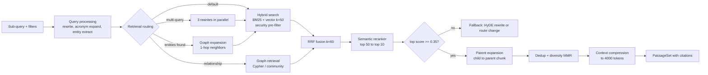

# 08 — Retrieval Architecture

## 1. Retrieval Methods Compared

| Method | How it works | Strengths | Weaknesses | Latency @ scale | Use in AdvanceRAG |
|---|---|---|---|---|---|
| **BM25** (lexical) | Term frequency / inverse doc frequency on inverted index | Exact terms, IDs, codes, names, acronyms; explainable; cheap | No synonyms/paraphrase; language-specific analyzers needed | 10–50 ms | Always on as part of hybrid |
| **Dense retrieval** | ANN (HNSW) over embeddings | Semantic similarity, paraphrase, cross-lingual | Misses rare exact tokens; embedding cost; opaque | 20–80 ms | Always on as part of hybrid |
| **Sparse learned** (SPLADE, BGE-M3 sparse) | Learned term-weight expansion on inverted index | Lexical precision + expansion; good for domain jargon | Extra model; not native in all engines | 20–60 ms | Optional tier (Milvus/Elastic) for jargon-heavy tenants |
| **Hybrid** | BM25 + dense (+ sparse) fused with RRF | Best overall recall/precision across query types | Two queries; fusion tuning | 40–120 ms | **Default** |
| **Graph retrieval** | Entity linking → traversal / community summaries | Multi-hop, relationships, global "themes" questions, explainable paths | Graph construction cost; schema drift; weaker for prose detail | 50–500 ms | Route C, and graph-augmented B |

**Recommendation:** Hybrid (BM25 + dense, RRF) **+ semantic re-ranking** as the default for route B; graph retrieval for relationship/multi-hop queries (route C) and as an augmentation (entity expansion) for B when the query contains linked entities.

Indicative quality (internal benchmarks typical of enterprise corpora; validate per tenant): hybrid + rerank improves nDCG@10 by ~15–30% over dense-only and ~20–40% over BM25-only.

## 2. Retrieval Pipeline

## 3. Retrieval Routing (inside route B/C)

| Query signal | Strategy |
|---|---|
| Contains IDs, codes, quoted phrases, part numbers | Hybrid with BM25 weight ↑ (`vectorWeight` 0.5), exact-match boost |
| Short / ambiguous (< 4 tokens) | Multi-query expansion + glossary expansion |
| Long natural language | Hybrid default |
| Sparse recall low (top BM25 & vector disagree, low scores) | HyDE: generate hypothetical answer (T0), embed, re-search |
| Named entities with graph presence | Graph expansion: add 1-hop related entities as filters/boost |
| "How is X related to Y", "who owns", "impact of" | Graph retrieval (route C) + supporting chunks |
| "Main themes across…", corpus-wide summaries | GraphRAG global search over community summaries |
| Time-sensitive ("latest", "current") | Freshness boost (scoring profile) + `effective_date` filter |
| Cross-lingual | Dense weight ↑ (multilingual embeddings), answer in user language |

## 4. Ranking & Re-ranking

1. **First stage:** AI Search hybrid query: BM25 (top 50) + HNSW vector (k=50, `exhaustive=false`, oversampling 2× with int8 rescoring) under **pre-filter** `tenant_id eq X and acl_group_ids/any(g: search.in(g, '...'))`.
2. **Fusion:** Reciprocal Rank Fusion:

$$
\text{RRF}(d) = \sum_{r \in R} \frac{1}{k + \text{rank}_r(d)},\quad k = 60
$$

3. **Scoring profiles:** freshness decay, authority boost (`doc_type = policy`, `source = official`), tenant-defined boosts.
4. **Re-ranking:** Azure AI Search semantic ranker (cross-encoder) on top 50 → top 10 (score 0–4, normalized to 0–1). For custom/sovereign tiers, self-hosted `bge-reranker-v2` on GPU.
5. **Minimum evidence threshold:** normalized rerank ≥ 0.35 on at least one chunk; otherwise fallback (see [03 §4](03-query-routing.md)).
6. **Diversity:** MMR (λ = 0.7) to avoid 10 chunks from one document unless the query is document-specific.

## 5. Context Compression

| Technique | Effect |
|---|---|
| Parent expansion with **budget-aware trimming** | Gives the LLM coherent context without exceeding budget |
| Sentence-level extractive compression (T0 or cross-encoder sentence scorer) | Keeps sentences with relevance ≥ τ; 40–60% token reduction, < 2% answer quality loss |
| Dedup near-duplicate passages (cos ≥ 0.95) | Removes version duplicates |
| Table summarization / column pruning | Keeps only relevant columns |
| Ordering: best at start and end | Mitigates lost-in-the-middle |
| Citation anchors preserved (`[doc_id:chunk_id:page]`) | Enables verification |

Budget: ≤ 4,000 evidence tokens for T1 synthesis, ≤ 8,000 for T2 multi-source.

## 6. Security in Retrieval

- **Pre-filtering only** (never post-filter after top-k — avoids leakage and recall loss).
- `acl_group_ids` stored as collection; user's effective groups (incl. nested, resolved & cached) passed as filter. For users with > 1,000 groups, groups are mapped to **ACL bitsets / access-tags** computed at ingestion to keep filters small.
- Large tenants on dedicated indexes → filter cardinality smaller → lower latency.
- Graph queries inject `tenant_id` and ACL predicates in Cypher templates; generative Cypher is parsed and rejected if predicates are missing.

## 7. Retrieval Evaluation

- Golden sets per tenant vertical (≥ 300 queries with relevance judgments, LLM-assisted + human verified).
- Metrics: Recall@50, nDCG@10, MRR, context precision/recall (RAGAS), answer groundedness.
- Run on every index/schema/embedding/chunking change; gate: no metric regresses > 2%.

**Enhancements:** Query-Conditioned Fusion (A7), Submodular Context Packing (A8) and Self-Healing Retrieval Loop (A14) — see [22](22-novel-algorithms-and-features.md).
