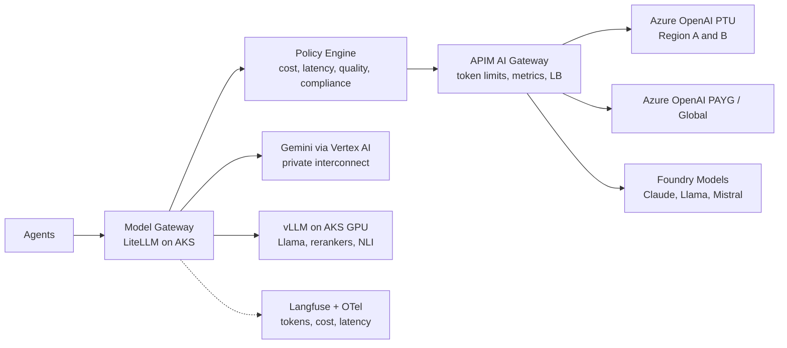

# 10 — Model Strategy

## 1. Model Tiers

Concrete model versions are pinned in the **Model Registry** (PostgreSQL + Langfuse) and change over time; this document defines tiers and policies, not specific versions.

| Tier | Class | Examples (families) | Used for | Relative cost | Typical TTFT |
|---|---|---|---|---|---|
| T0 | Small / local | Llama (8B-class) on AKS GPU or Foundry, Phi, GPT nano-class, Gemini Flash-Lite-class | Query rewrite, classification fallback, memory extraction, NLI, compression, simple chit-chat | 1× | 100–300 ms |
| T1 | Mid | GPT mini-class, Claude Haiku/Sonnet-class, Gemini Flash-class | Default RAG synthesis, SQL generation, tool selection, planning | 5–15× | 300–700 ms |
| T2 | Frontier | GPT flagship / reasoning, Claude Opus/Sonnet top-class, Gemini Pro-class | Complex multi-source synthesis, high-risk domains, critic, hard reasoning | 30–100× | 600–2,000 ms |
| Embedding | — | text-embedding-3-large (1024-d MRL) primary; open model (e.g., BGE-M3 / E5) on AKS as fallback & sovereign option | Docs, queries, memory, cache | — | 20–80 ms |
| Rerank | — | Azure AI Search semantic ranker; cross-encoder (bge-reranker) on AKS for custom | Retrieval | — | 50–120 ms |

**Default traffic mix target:** T0 35% of calls, T1 55%, T2 ≤ 10%.

## 2. Model Gateway

- **LiteLLM** provides a unified OpenAI-compatible API, provider adapters, retries, fallbacks and per-tenant budgets.
- **APIM** fronts all Azure-hosted endpoints: `llm-token-limit`, `llm-emit-token-metric`, backend pools with priority + circuit breaker (PTU first, PAYG spillover), content-safety policy.
- **Compliance pools:** tenants flagged HIPAA/EU-residency only see models deployed in compliant regions/agreements (e.g., EU Data Zone deployments); enforced by the policy engine before selection.

## 3. Routing Policies

Each candidate model $m$ for a task $t$ is scored:

$$
U(m) = w_q\,Q(m,t) - w_c\,\hat{C}(m,t) - w_l\,\hat{L}(m) \quad \text{s.t. compliance}(m)=\text{true},\ \text{health}(m)=\text{up}
$$

| Term | Source |
|---|---|
| $Q(m,t)$ | Offline eval score per task type (golden sets) + online win-rate from feedback |
| $\hat{C}$ | Expected cost from estimated input/output tokens × price (cached-prefix discount applied) |
| $\hat{L}$ | Rolling P95 TTFT + tokens/s from the last 5 min (Prometheus) |
| $w_q, w_c, w_l$ | Tenant plan profile: **Economy** (0.4/0.4/0.2), **Balanced** (0.5/0.25/0.25), **Premium** (0.7/0.1/0.2) |

### 3.1 Cost-aware routing

- Start at the **lowest tier that meets the task's quality floor** (e.g., SQL generation floor = T1).
- Router `model_tier_hint` from query complexity (length, entity count, multi-hop flag, risk).
- **Cascade:** T1 generates → Verification fails due to reasoning → regenerate on T2 (only ~5–8% of requests).
- Per-tenant daily/monthly budgets; at 80% usage → shift Balanced → Economy profile; at 100% → T0/T1 only + admin alert.
- Batch API (50% discount) for offline jobs: re-summarization, memory consolidation, eval runs, GraphRAG community summaries.

### 3.2 Latency-aware routing

- Live P95 TTFT per deployment; if a deployment exceeds its SLO by > 30% for 2 min, its weight is reduced.
- Interactive requests prefer **PTU** (predictable latency); spillover to PAYG/Global Standard.
- Streaming always on for chat; speculative execution for T2: start T1 draft streaming when T2 TTFT > 2 s (used only for low-risk).
- Region affinity: call models in the same region as the stamp; cross-region only on failover.

### 3.3 Quality-aware routing

- Task-specific champions (e.g., Claude-class for long-document synthesis, GPT-class for tool calling/SQL, Gemini-class for very long multimodal context) maintained from weekly eval runs.
- High-risk (risk ≥ 0.5) → T2 generator and a **different-family** critic.
- Online A/B (5% traffic) for challenger models; promotion requires win-rate ≥ 52% with no regression in groundedness.

## 4. Automatic Fallback

| Failure | Fallback |
|---|---|
| 429 / quota | Same model next backend in pool (other PTU region → PAYG) |
| 5xx / timeout | Retry once (jitter), then equivalent model from another provider in the same tier |
| Content filter false positive | Re-route to alternate provider with equal compliance, log for review |
| Circuit open on provider | Tier-equivalent substitute map, e.g., T1: GPT mini ↔ Claude Haiku ↔ Gemini Flash ↔ Llama 70B local |
| Region outage | Model Gateway in surviving region; PTU capacity planned for N+1 |
| All external providers down | Local vLLM T0/T1 (Llama) degraded mode, grounded routes only |

Fallback events are emitted as metrics (`llm.fallback{from,to,reason}`) and alerted when > 2% of traffic.

## 5. Local Models (Llama et al.)

- Served with **vLLM** on AKS GPU node pools (A100/H100 or newer), KEDA autoscaling on queue depth and GPU utilization; spot GPUs for batch.
- Use cases: T0 workloads (rewrite, NLI, compression, classification), sovereign/air-gapped tenants, degraded mode.
- Fine-tuned LoRA adapters per vertical (multi-LoRA serving) for SQL dialects and domain terminology.
- Break-even: local serving is preferred when sustained utilization > ~40% of a GPU node; otherwise serverless Foundry endpoints.

## 6. Prompt & Output Controls

- Structured outputs (JSON schema) for router, planner, SQL, tool args.
- Temperature 0–0.2 for grounded routes; 0.7 only for creative route A.
- Max output tokens per route (A: 800, B/C: 1,200, F: 3,000).
- Stable prompt prefix ordering to maximize provider prompt-cache hits.

**Enhancements:** Speculative Model Cascade (A10) and Spend-Pacing Controller (A11) — see [22](22-novel-algorithms-and-features.md).
