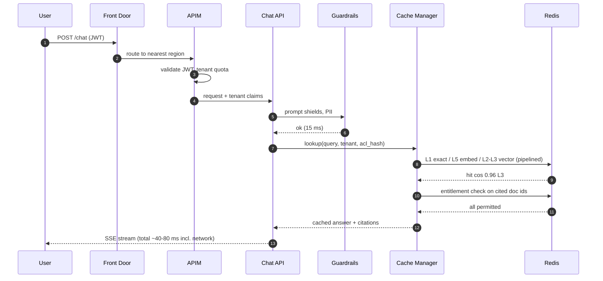
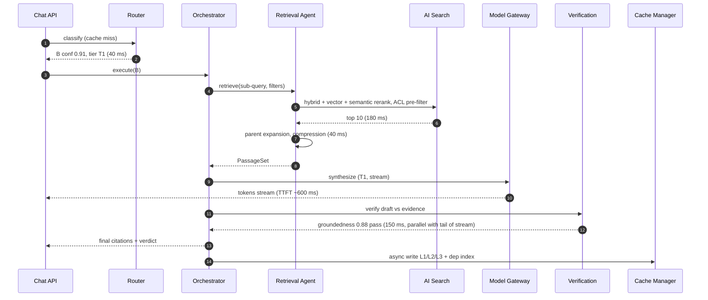
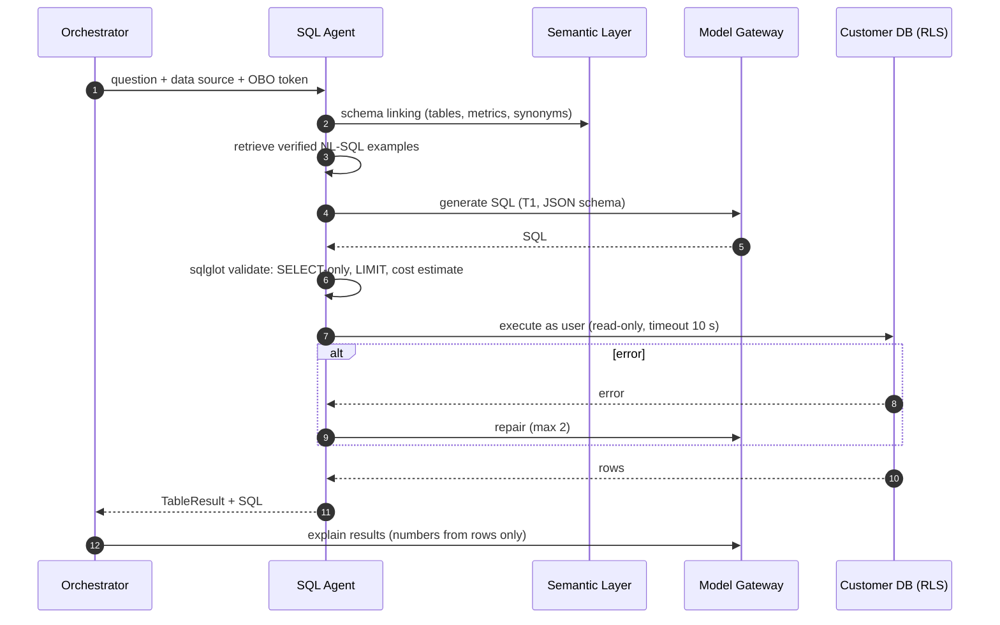
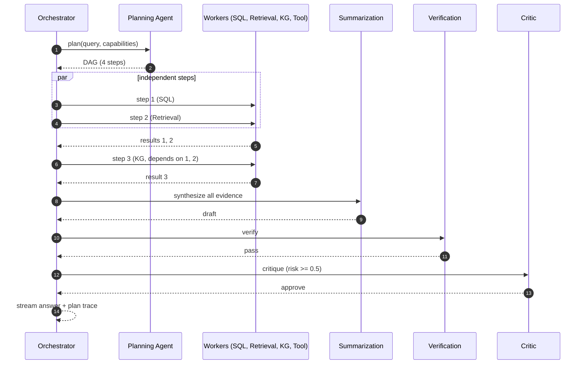
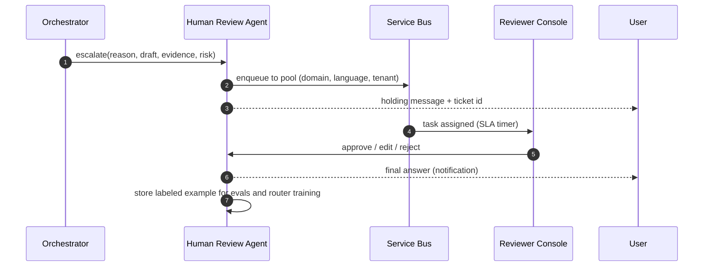
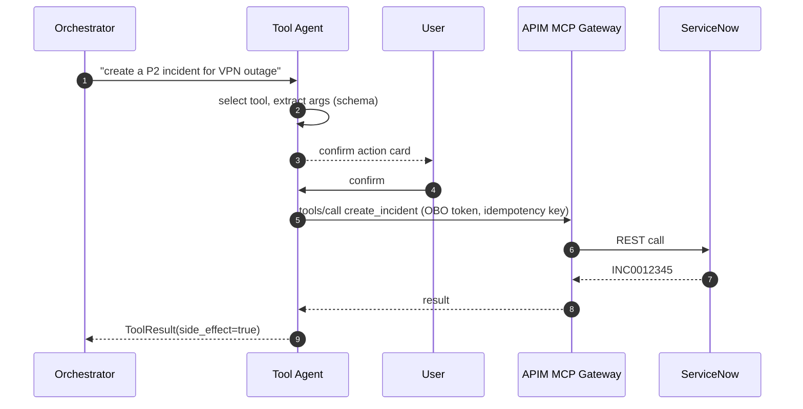
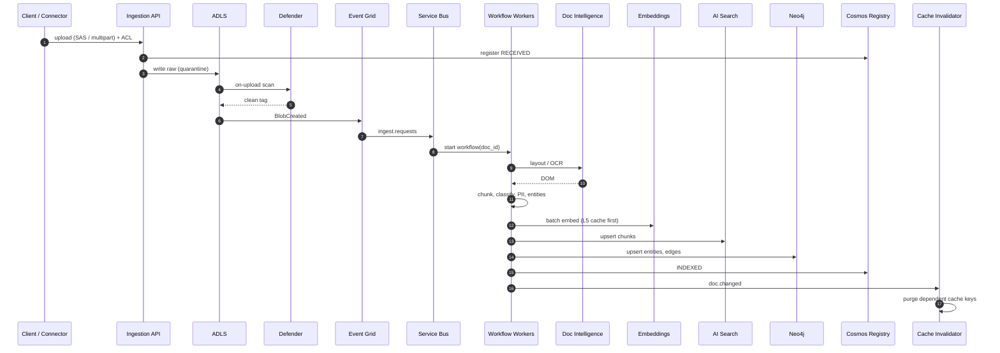

# 11 — Data Flow Diagrams

Sequence diagrams for each execution path. Latencies are typical server-side P50 values.

## 1. Cache Hit (Route G)

## 2. RAG (Route B)

Verification runs incrementally on completed sentences while streaming; if it fails, the client receives a `revision` event and the corrected answer replaces the draft (or the UI withholds display for high-risk tenants until verification completes).

## 3. SQL (Route D)

## 4. Multi-Step Agent (Route F)

Long-running (> 30 s) plans are converted to **async jobs**: the client receives a job id and progress events over SSE/WebSocket; results are delivered to the conversation and optionally via Teams/email.

## 5. Human Escalation (Route H)

## 6. Tool Call with Side Effect (Route E)

## 7. Ingestion Flow

