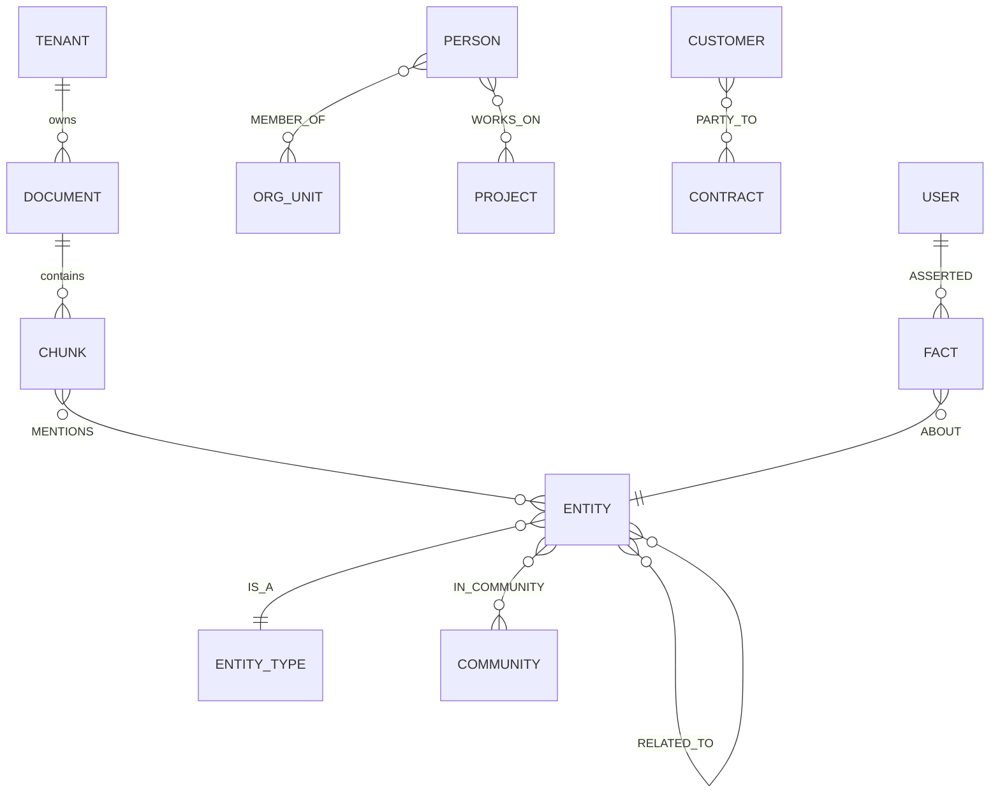

# 12 — Database Design

## 1. Store Responsibilities

| Store | System of record for | Why this store |
|---|---|---|
| **ADLS Gen2** | Raw files, processed DOM JSON, chunk Parquet, long-term memory (Delta), audit archive | Cheap, tiered, immutable policies, re-index source of truth |
| **Cosmos DB (NoSQL)** | Tenant catalog (global), document registry & pipeline state, conversations, user memory, HITL tasks | Global distribution, multi-region writes, elastic scale, TTL |
| **PostgreSQL Flexible Server** | Relational metadata: tenants config, users/groups cache, ACLs, agent/model/prompt registry, semantic layer, billing aggregates, ingested tabular data (per tenant schema) | Strong consistency, RLS, joins, mature tooling |
| **Azure AI Search** | Chunk index, memory indexes | Hybrid search |
| **Neo4j** | Entities, relationships, communities, semantic memory facts | Native graph traversal, GraphRAG |
| **Azure Managed Redis** | Caches, session/conversation hot state, rate limits | Sub-ms latency (not a system of record) |
| **Azure Data Explorer (ADX)** | Telemetry analytics, cost/token facts, route analytics | Time-series analytics at scale |

## 2. Cosmos DB Containers

| Container | Partition key | Key fields | TTL |
|---|---|---|---|
| `tenants` (global account) | `/tenantId` | name, tier (shared/dedicated/isolated), home region, stamp id, residency, compliance flags, model policy, budgets | none |
| `documents` | `/tenantId` + hierarchical `/docId` | docId, version, contentHash, sourceUri, status (RECEIVED, SCANNED, EXTRACTED, CHUNKED, EMBEDDED, INDEXED, FAILED, DELETED), stage timings, errors[], chunkCount, parentDocId, aclVersion, legalHold | none (soft-delete) |
| `conversations` | `/tenantId` + `/userId` (hierarchical) | convId, title, createdAt, summary, facts[], lastRoute | per tenant policy |
| `messages` | `/tenantId` + `/convId` | msgId, role, content, citations[], route, model, tokens, cost, verdict, feedback | per tenant policy |
| `user_memory` | `/tenantId` + `/userId` | memoryId, type (preference, fact), text, importance, source, createdAt, lastAccessed | none |
| `hitl_tasks` | `/tenantId` | taskId, reason, risk, payload ref, assignee pool, status, SLA due, decision | 2 yrs |
| `agent_checkpoints` | `/threadId` | LangGraph durable checkpoints | 30 days |

Consistency: **Session** consistency for user-facing containers; **Bounded staleness** for `tenants`. Multi-region writes enabled for `conversations`/`messages`; conflict policy last-writer-wins on `_ts`.

## 3. PostgreSQL Schema (core)

All tenant-scoped tables have `tenant_id uuid not null` and **RLS** policy `tenant_id = current_setting('app.tenant_id')::uuid`. The application sets `app.tenant_id` and `app.user_groups` per transaction from the verified token; the app role has no `BYPASSRLS`.

| Table | Key columns | Notes |
|---|---|---|
| `tenant_config` | tenant_id PK, plan, model_profile, cache_opt_out_l4, retention_days, residency_region | |
| `principals` | tenant_id, principal_id PK, type (user/group/service), display_name, entra_object_id | synced from Entra |
| `group_membership` | tenant_id, group_id, member_id | nested groups flattened nightly + on change |
| `doc_acl` | tenant_id, doc_id, principal_id, permission (read/write/owner), source | PK (tenant_id, doc_id, principal_id) |
| `access_tags` | tenant_id, tag_id, principal_set_hash | compresses large ACLs for search filters |
| `data_sources` | tenant_id, source_id, type (sql, api, graph), connection_ref (Key Vault URI), cacheable_minutes, owner | |
| `semantic_layer` | tenant_id, source_id, entity, column, description, synonyms[], metric_sql, pii | used by SQL Agent |
| `nl_sql_examples` | tenant_id, source_id, question, sql, verified_by, embedding_ref | agent memory |
| `agents` | agent_id, version, prompt_version, allowed_tools[], allowed_models[], owner, status | global |
| `models` | model_id, provider, tier, region, compliance_tags[], price_in, price_out, status | registry |
| `tools` | tool_id, mcp_server, schema, side_effect, required_scopes[], rate_limit | |
| `usage_daily` | tenant_id, date, user_id, route, model_id, tokens_in, tokens_out, cost_usd, cache_hits | partitioned by month |
| `audit_index` | tenant_id, event_id, ts, actor, action, resource, hash | pointer to immutable store |

Row-level security example (conceptual): a tenant-shared `sales_facts` table may also have `region` RLS: `region = any(string_to_array(current_setting('app.user_regions'), ','))`.

Tabular uploads (Excel/CSV) land in **per-tenant schemas** (`t_{tenant}`) with RLS inherited; large analytical data can alternatively land in Fabric/Databricks lakehouse and be exposed to the SQL Agent via a read-only SQL endpoint.

## 4. Azure AI Search Index — `chunks`

| Field | Type | Attributes |
|---|---|---|
| `chunk_id` | Edm.String | key |
| `doc_id`, `parent_chunk_id` | Edm.String | filterable |
| `tenant_id` | Edm.String | filterable (mandatory filter) |
| `acl_group_ids` | Collection(Edm.String) | filterable |
| `acl_user_ids` | Collection(Edm.String) | filterable |
| `access_tags` | Collection(Edm.String) | filterable |
| `sensitivity_label`, `clearance_level` | String / Int32 | filterable |
| `title`, `heading_path` | String | searchable (boosted) |
| `content` | String | searchable (language analyzer) |
| `content_vector` | Collection(Edm.SByte) 1024 | vector, HNSW (m=8–16, efConstruction 400, efSearch 100), int8, `stored=false` |
| `doc_type`, `language`, `source_system`, `department`, `project` | String | filterable, facetable |
| `entities`, `keyphrases` | Collection(String) | searchable, filterable |
| `page`, `start_ms`, `end_ms` | Int32/Int64 | retrievable |
| `created_at`, `modified_at`, `effective_date` | DateTimeOffset | filterable, sortable |
| `source_uri` | String | retrievable |
| `version`, `content_hash` | String | filterable |
| `is_deleted` | Boolean | filterable |

Scoring profile `default`: freshness on `modified_at` (boost 1.5, 365-day interpolation), tag boost on `doc_type`. Semantic configuration: title=`title`, content=`content`, keywords=`keyphrases`.

Additional indexes: `memory` (user/org/long-term), `agent_memory` (plans, SQL/Cypher examples), `faq_pinned`.

## 5. Neo4j Graph Model

- Every node/edge carries `tenant_id`, `acl_tags[]`, `source_chunk_ids[]`, `confidence`, `valid_from/valid_to`.
- Relationship types are a governed vocabulary per tenant vertical (≤ 50), with `RELATED_TO {type}` as catch-all.
- `COMMUNITY` nodes hold Leiden-clustered GraphRAG community summaries (levels 0–2), refreshed incrementally.
- Large tenants → dedicated Neo4j database (multi-database); small tenants share a database with `tenant_id` predicates enforced by query templates + a server-side procedure guard.
- Indexes: composite on `(tenant_id, name)`, full-text on aliases, vector index on entity description embeddings for entity linking.

## 6. Redis Keyspace

See [05 §2](05-memory-architecture.md) (memory) and [06 §1](06-cache-architecture.md) (cache). Additional:

| Key | Purpose |
|---|---|
| `dep:{tenant}:{doc_id}` | Set of cache keys depending on a document (invalidation reverse index) |
| `ent:{tenant}:{user}` | Entitlement bitmap / group set hash (for cache ACL re-check) |
| `route:prior:{tenant}` | Hourly route success priors |
| `cb:{dependency}` | Circuit-breaker state (shared across pods) |

## 7. ADLS Layout

| Zone | Path | Tier policy |
|---|---|---|
| Quarantine | `/quarantine/{tenant}/{yyyy}/{mm}/{doc_id}` | Hot, 30-day delete |
| Raw | `/raw/{tenant}/{source}/{doc_id}/{version}` | Hot 30 d → Cool 90 d → Cold 1 yr → Archive |
| Processed | `/processed/{tenant}/{doc_id}/{version}/dom.json, chunks.parquet` | Hot 90 d → Cool (retained for re-index) |
| Embeddings | `/embeddings/{model_id}/{tenant}/part-*.parquet` | Cool (re-index acceleration) |
| Memory | `/ltm/{tenant}/delta/` | Cool |
| Audit | `/audit/{yyyy}/{mm}/` | Immutable (WORM), Cool → Archive |

## 8. Data Lifecycle & Consistency

- **Write path order:** ADLS (raw) → Cosmos registry → processing → ADLS processed → Search/Neo4j/PG → registry `INDEXED` → `doc.indexed` event. Registry is the coordination point; idempotent upserts keyed by `(doc_id, version, chunk_id)`.
- **Deletion cascade:** registry `DELETED` → soft-delete flag in Search (immediate) → hard delete in Search, Neo4j, PG, ADLS processed, caches (≤ 24 h) → raw purge per retention/legal hold.
- **Reconciliation job (daily):** compares registry vs. index counts per tenant; repairs drift.

**Enhancement:** the graph model is extended to a Bitemporal Knowledge Graph (A15) with valid and transaction time — see [22](22-novel-algorithms-and-features.md).
