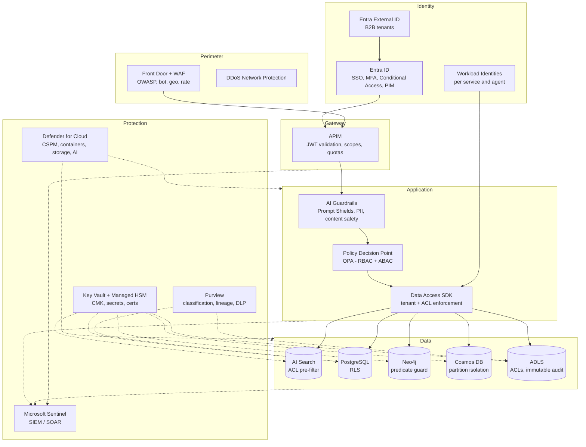

# 13 — Security Architecture

## 1. Principles

Zero trust (verify explicitly, least privilege, assume breach) · Tenant isolation by construction · Security trimming at the data layer, not the UI · No secrets in code or config · Every AI action attributable and auditable.

## 2. Security Architecture Diagram

## 3. Identity & Access

| Control | Design |
|---|---|
| User authN | Entra ID (OIDC), MFA, Conditional Access (device compliance, location, risk); B2B/External ID for partner tenants; SAML/OIDC federation for customers' IdPs |
| Service authN | Managed identities / workload identity federation on AKS — no client secrets; each agent has its own identity |
| Delegated access | **On-Behalf-Of** flow: downstream systems (SQL sources, Graph, ServiceNow) see the end user's identity, so source-system permissions apply |
| Privileged access | PIM just-in-time for admins; break-glass accounts monitored |

### 3.1 RBAC

| Role | Scope | Permissions |
|---|---|---|
| Platform Admin | Platform | Stamps, models, global policies (PIM-gated) |
| Tenant Admin | Tenant | Users, data sources, connectors, retention, budgets |
| Knowledge Manager | Tenant / collection | Upload, curate, pin answers, manage glossary |
| Analyst | Tenant | Chat + SQL/data routes, export |
| User | Tenant | Chat over entitled content |
| Reviewer | Tenant / domain pool | HITL queue |
| Auditor | Tenant | Read audit logs, reports (no content by default) |

### 3.2 ABAC

Policies evaluated by **OPA** (Rego) sidecar/library (< 2 ms, decisions cached per request). Attributes: user (department, region, clearance, employment type), resource (sensitivity label, doc type, owner department, residency), context (device compliance, network, time, risk score), action (read, summarize, export, tool-invoke).

Examples:

- `deny summarize|export if resource.sensitivity == "Highly Confidential" and not user.clearance >= 3`
- `allow tool.invoke(finance.*) if user.department == "Finance" and context.device_compliant`
- `deny route A for tenant.policy.grounded_only == true`

### 3.3 Document-level security (security trimming)

1. Source ACLs captured at ingestion (SharePoint/Graph permissions, file-share ACLs, connector mappings) → normalized principals in `doc_acl`.
2. Chunks indexed with `acl_group_ids`, `acl_user_ids`, `access_tags`, `sensitivity_label`.
3. At query time: user effective groups (transitive, cached 10 min, invalidated on change) → **pre-filter** in AI Search; same predicates in Neo4j and in cache keys (`acl_hash`).
4. ACL changes propagate via fast lane (< 60 s target).
5. Verification Agent re-checks entitlement on every cited doc before response (defense in depth).

### 3.4 Row-level security

- PostgreSQL RLS on all tenant tables (`tenant_id`) + business RLS (region, cost center) from session variables set by the Data Access SDK.
- Customer SQL sources: SQL Agent connects with **user OBO** where supported (Azure SQL, Fabric, Databricks Unity Catalog), so source RLS/column masking apply; otherwise a service principal with views pre-filtered by a user-attribute mapping.
- Column-level: semantic layer marks PII columns; SQL Agent rejects queries selecting masked columns unless ABAC allows.

## 4. AI-Specific Threats

| Threat | Controls |
|---|---|
| Direct prompt injection / jailbreak | Azure AI Content Safety Prompt Shields on input; system prompt hardening; route L0 block |
| Indirect injection (malicious content in docs/tool output) | Prompt Shields document mode on retrieved chunks; content marked as data (delimiters/spotlighting); tools never auto-execute instructions found in content |
| Data exfiltration via tools | Tool allow-lists per agent; egress via APIM only; side-effect confirmation; DLP on outbound payloads |
| Cross-tenant leakage | Tenant id mandatory in SDK; per-tenant keys in caches; isolation tests in CI (canary tenants with honeytoken docs) |
| Excessive agency | Budgets, step limits, HITL for high-risk actions, read-only DB roles |
| Model output harms | Content safety on output, groundedness checks, Critic for high-risk |
| Training data leakage | Provider no-training agreements; zero data retention options where available; abuse monitoring exemptions for regulated tenants |
| Supply chain (models, packages) | Model registry with approval; signed containers (Notation), SBOM, Defender for Containers, dependency scanning |

## 5. Encryption

| Layer | Control |
|---|---|
| In transit | TLS 1.2+ everywhere (TLS 1.3 at edge), mTLS between services (service mesh / Istio-based AKS add-on) |
| At rest | Platform encryption by default; **CMK** (Key Vault / Managed HSM) for ADLS, Cosmos DB, PostgreSQL, AI Search, Redis, Service Bus, AKS disks for dedicated/isolated tenants |
| Per-tenant keys | Isolated tier: tenant-specific CMK (BYOK supported); crypto-shredding on tenant offboarding |
| Application-level | Field-level encryption for highly sensitive memory/PII fields (envelope encryption with DEKs) |
| Confidential compute (optional) | Confidential VMs/containers for sovereign tenants |

## 6. Secret Management

- Azure Key Vault (per stamp, per environment) with RBAC, private endpoint, soft-delete + purge protection.
- Secrets Store CSI driver on AKS; automatic rotation (≤ 90 days), event-driven reload.
- Customer connection strings stored as Key Vault references in `data_sources.connection_ref`; never logged.
- Secret scanning in CI (GitHub Advanced Security) and pre-commit hooks.

## 7. Network Security

- Hub-spoke VNets; all PaaS via **Private Endpoints**; public network access disabled on data services.
- AKS private cluster, Azure CNI Overlay, network policies (Cilium), egress via Azure Firewall Premium (FQDN allow-list for model providers and connectors).
- APIM in internal VNet mode behind Front Door Private Link origin.

## 8. Audit Logging

- Events: authN, authZ decisions (allow/deny with policy id), queries (hash + optionally full text per tenant policy), routes, documents cited, tool calls (args redacted), admin changes, data exports, HITL decisions.
- Pipeline: OTel/Diagnostic settings → Event Hubs → ADX (hot query, 1 yr) + ADLS immutable WORM (7 yrs) + Sentinel.
- Tamper evidence: hash-chained audit records; daily digest anchored to immutable storage.
- Tenant self-service audit export API.

## 9. Compliance Mapping

| Control area | SOC 2 | ISO 27001:2022 | GDPR | HIPAA | Platform implementation |
|---|---|---|---|---|---|
| Access control | CC6.1–6.3 | A.5.15–5.18, A.8.2–8.5 | Art. 32 | §164.312(a) | Entra, RBAC/ABAC, PIM, RLS, security trimming |
| Encryption | CC6.1, CC6.7 | A.8.24 | Art. 32 | §164.312(a)(2)(iv), (e) | TLS, CMK, field-level encryption |
| Logging & monitoring | CC7.2–7.3 | A.8.15–8.16 | Art. 30, 33 | §164.312(b) | Immutable audit, Sentinel, alerts |
| Change management | CC8.1 | A.8.32 | — | — | GitOps, approvals, eval gates |
| Vendor management | CC9.2 | A.5.19–5.22 | Art. 28 | BAA | Model provider DPAs/BAAs, registry |
| Data minimization & retention | P4 | A.5.33–5.34 | Art. 5(1)(c),(e) | §164.530(j) | Retention policies, TTLs, PII redaction |
| Data subject rights | P5–P6 | A.5.34 | Art. 15–22 | §164.524 | DSAR API: export, erase (cascade incl. memory, caches, indexes) |
| Residency & transfers | — | A.5.34 | Ch. V | — | Region-pinned stamps, EU Data Boundary, Data Zone model deployments |
| Incident response | CC7.4–7.5 | A.5.24–5.28 | Art. 33–34 | §164.308(a)(6) | Sentinel playbooks, 72 h breach workflow |
| Business continuity | A1.2–A1.3 | A.5.29–5.30 | Art. 32(1)(c) | §164.308(a)(7) | Multi-region DR ([17](17-disaster-recovery.md)) |
| AI governance | — | ISO/IEC 42001 (extension) | — | — | Model registry, evals, HITL, transparency notes |

HIPAA tenants: PHI processed only in BAA-covered services and model deployments; PHI excluded from L4/global caches and long-term anonymized memory; minimum-necessary enforced through ABAC.
