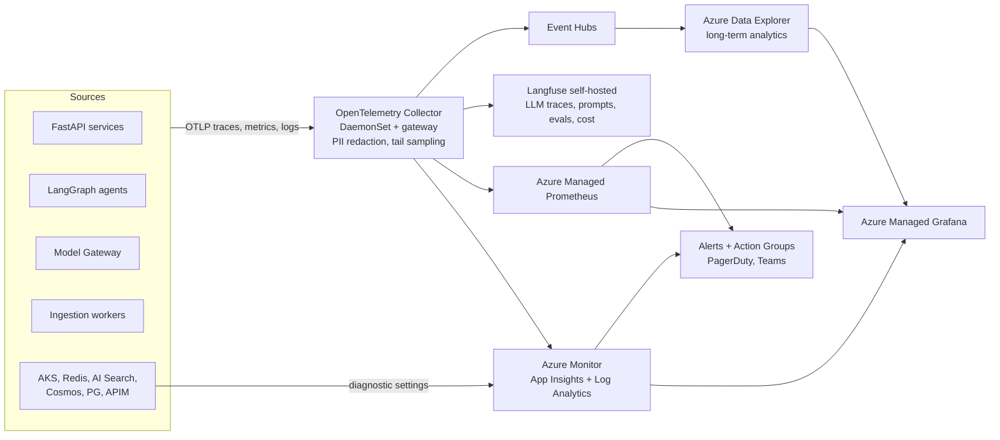

# 14 — Observability

## 1. Architecture

- **Instrumentation:** OpenTelemetry Python SDK with auto-instrumentation (FastAPI, httpx, redis, asyncpg, azure-sdk) + **OpenTelemetry GenAI semantic conventions** for LLM spans (`gen_ai.request.model`, `gen_ai.usage.input_tokens`, …). LangGraph node callbacks emit spans and Langfuse observations.
- **Correlation:** W3C `traceparent` propagated from APIM through agents, Service Bus messages and tool calls; `tenant.id`, `user.hash`, `conversation.id`, `route`, `agent.name` as span attributes.
- **Sampling:** 100% of errors, slow (> P95), HITL and thumbs-down traces; 10% of normal traces (tail sampling in collector); Langfuse receives 100% of LLM generations metadata (content per tenant policy).
- **PII:** collector processors redact emails, phone numbers, IDs; prompt/response bodies stored only for tenants that opt in, encrypted, with retention ≤ 30 days.

## 2. Signals

### 2.1 Monitoring (metrics)

| Category | Key metrics |
|---|---|
| Golden signals | RPS, error rate, P50/P95/P99 latency per route and per stage, saturation |
| Router | Route distribution, confidence histogram, fallback rate, planner usage %, clarification rate |
| Cache | Hit rate per level, false-hit reports, lookup latency, evictions, memory |
| Retrieval | Search latency, top rerank score distribution, empty-result rate, throttling (503/207) |
| LLM | TTFT, tokens/s, tokens in/out, 429 rate, fallback events, PTU utilization |
| Agents | Steps per request, budget exhaustion, timeouts per agent |
| Quality | Groundedness, citation coverage, abstention rate, thumbs up/down, HITL rate |
| Ingestion | Docs/min per stage, queue depth, DLQ depth, freshness lag P95, OCR pages/min |
| Infra | Node/pod CPU, memory, GPU utilization, KEDA scaler state |

### 2.2 Logging

Structured JSON logs (one schema across services) → Log Analytics (30-day interactive) → ADX (1 yr). Log levels controlled dynamically per tenant for troubleshooting.

### 2.3 Tracing

End-to-end trace per request spanning gateway → guardrails → cache → router → each agent node → retrieval → model calls → verification → cache write. Langfuse shows the LLM-centric view (prompt version, inputs/outputs, scores) linked by `trace_id` to App Insights.

## 3. Cost & Token Tracking

- Model Gateway computes cost per call: `tokens_in × price_in + cached_tokens × price_cached + tokens_out × price_out` from the model registry; emits `llm.cost.usd` with tenant/route/agent/model dimensions.
- Non-LLM unit costs (search query, embedding, OCR page, transcription minute) emitted as metered events from the corresponding services.
- Aggregated hourly into `usage_daily` (PostgreSQL) for billing/chargeback and into ADX for analytics.
- Dashboards: cost per query (by route), cost per tenant, cache savings (`avoided_cost` = estimated cost of the full path on a cache hit), PTU utilization vs. PAYG spillover.
- Budgets & anomalies: per-tenant budget alerts at 50/80/100%; ADX anomaly detection on cost per tenant per hour.

## 4. Prompt Monitoring

- All prompts versioned in **Langfuse Prompt Management**; services fetch by label (`production`, `canary`) with local cache.
- Each generation records `prompt_name`, `prompt_version`; dashboards compare quality, latency and cost across versions.
- Canary rollout: 5% → 25% → 100% gated by online metrics (groundedness, thumbs-down, latency).
- Drift detection: embedding-cluster analysis of incoming queries (weekly) surfaces new topics not covered by corpora or router training.

## 5. Hallucination Tracking

| Signal | Source | Use |
|---|---|---|
| Groundedness score per answer | Verification Agent / Content Safety groundedness | Distribution per tenant/route/model; alert if P10 < 0.7 |
| Unsupported-claim count | Verification Agent | Trend, prompt tuning |
| Citation validity | Verification (cited chunk actually supports sentence) | Retrieval/prompt quality |
| Numeric mismatch (SQL) | Numeric checker | SQL route correctness |
| User reports | "Report inaccuracy" UI | Labeled data |
| HITL edits | Reviewer diffs | Gold labels |
| Offline evals | Nightly LLM-as-judge + RAGAS (faithfulness, answer relevance, context precision) on golden sets | Release gates |

**Hallucination rate KPI** = answers with groundedness < 0.80 that were served (not caught) ÷ total grounded answers, measured on a 1% human-audited sample. Target < 1%.

## 6. Dashboards (Grafana)

1. **Executive:** queries/day, active users, P50/P95/P99, availability, cost/day, cost/query, cache savings, satisfaction.
2. **SRE:** golden signals per region/stamp, dependency health, circuit breakers, error budgets.
3. **AI Quality:** route accuracy (from feedback), groundedness, abstention, HITL, hallucination KPI, per-model win-rates.
4. **Cost:** per tenant/route/model, PTU utilization, embedding/OCR spend, forecast.
5. **Ingestion:** throughput, backlog, freshness, failures by stage and file type.
6. **Tenant view** (exposed to tenant admins): usage, cost, quality, top unanswered questions (content gaps).

## 7. SLOs & Alerting

| SLO | Target | Error budget policy |
|---|---|---|
| Availability (chat API) | 99.95% / 30 d | Freeze risky deployments when 50% budget burned |
| Latency P95 (non-agent routes) | < 5 s | Burn-rate alerts (1 h / 6 h windows) |
| Freshness P95 | < 5 min | Scale ingestion lanes |
| Groundedness P50 | ≥ 0.90 | Roll back prompt/model |
| Hallucination KPI | < 1% | Incident review |

Multi-window, multi-burn-rate alerts; runbooks linked in every alert.
