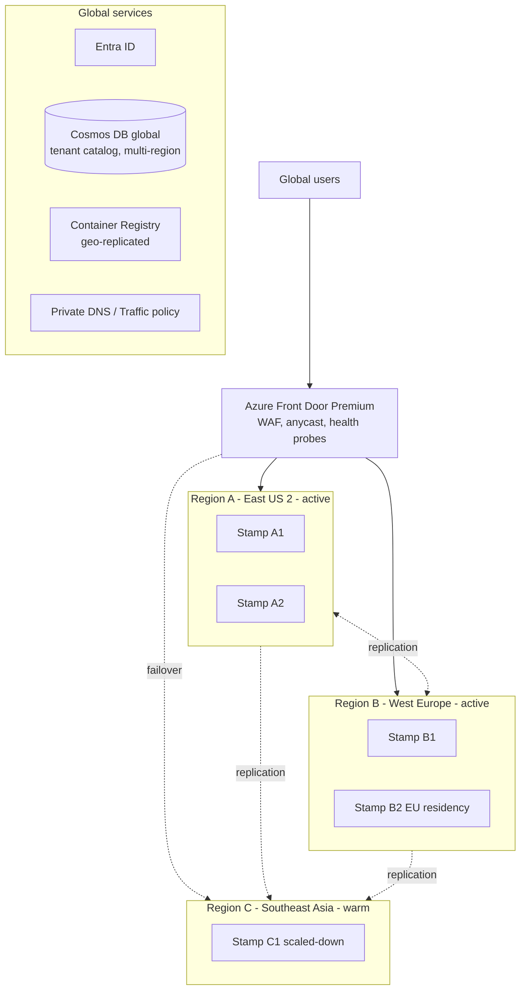
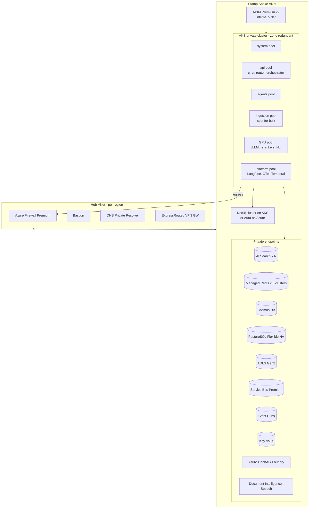

# 15 — Azure Deployment Architecture

## 1. Global Topology

- **Active-active** in two primary regions; **warm standby** third region (scaled to ~25%, can scale out in < 20 min).
- **Residency stamps** (EU, UK, etc.) keep data in-region; such tenants fail over only to paired in-geography regions.
- Tenant → stamp assignment in the global catalog; Front Door routes by tenant header/host to the tenant's home stamp, with latency-based routing for global, non-pinned tenants.

## 2. Stamp (Scale Unit) Composition

### 2.1 Stamp sizing (initial, per stamp: ~2,500 concurrent users, ~25M docs, ~500M chunks)

| Component | SKU / configuration |
|---|---|
| AKS | Standard tier (uptime SLA), 3 AZs. api pool: D16ds_v5 × 6–30 (HPA); agents pool: D16ds_v5 × 6–40; ingestion: D16ds_v5 × 4–60 (spot for bulk lane); GPU: NC A100/H100-class × 2–8; platform: D8ds_v5 × 3–6 |
| APIM | Premium v2, 2+ units, zone redundant |
| AI Search | 2–4 services, S3 / L2, 3–6 replicas, partitions sized to index (int8, `stored=false`) |
| Managed Redis | Cache: Balanced 100–200 GB; Embedding: Memory-optimized 200–400 GB; Memory: Balanced 50 GB; all zone-redundant + geo-replicated |
| Cosmos DB | Autoscale RU/s (20k–200k), multi-region writes for conversations |
| PostgreSQL | Flexible Server, General Purpose/Memory-optimized 16–32 vCores, zone-redundant HA, read replicas, cross-region replica |
| Service Bus | Premium 2–4 MUs, geo-replication |
| Event Hubs | Premium / Dedicated for telemetry |
| ADLS Gen2 | ZRS/GZRS (RA-GZRS for processed zone) |
| Azure OpenAI | PTU deployments for T1/T2 in both active regions + Global/Data Zone Standard spillover |
| Neo4j | Enterprise 3-core cluster (+ read replicas) on memory-optimized nodes |

## 3. Landing Zone & Subscriptions

| Management group | Subscriptions |
|---|---|
| Platform | Connectivity (hubs, Front Door, DNS), Identity, Management (Log Analytics, Sentinel, Grafana) |
| Landing zones / Corp | `nexus-prod-{region}-{stamp}` (one per stamp), `nexus-shared-prod` (ACR, global Cosmos) |
| Landing zones / Non-prod | `nexus-dev`, `nexus-test`, `nexus-perf` |
| Sandbox | Experiments |

Azure Policy initiatives: deny public endpoints, enforce CMK where required, allowed regions per residency, diagnostic settings, Defender plans, tag compliance.

## 4. Delivery

- **IaC:** Bicep (or Terraform) modules per stamp; stamps stamped out from the same versioned module.
- **GitOps:** Flux on AKS for application manifests (Helm); progressive delivery with Argo Rollouts / Flagger (canary by tenant ring: internal → early adopters → all).
- **Release rings:** Ring 0 (internal tenant) → Ring 1 (5% tenants) → Ring 2 (one region) → Ring 3 (global).
- **Gates:** unit/integration tests, security scans, offline AI eval suite, load test in `perf` for major releases.
- **Images:** signed (Notation), scanned (Defender), pulled from geo-replicated ACR via private endpoint.

## 5. Environment Strategy

| Env | Purpose | Data |
|---|---|---|
| dev | Feature development | Synthetic |
| test | Integration, contract tests | Synthetic + anonymized samples |
| perf | Load & chaos testing at 1:4 prod scale | Synthetic corpus 25M docs |
| staging | Release validation, eval suite | Opt-in tenant shadows |
| prod | Production stamps | Customer |
