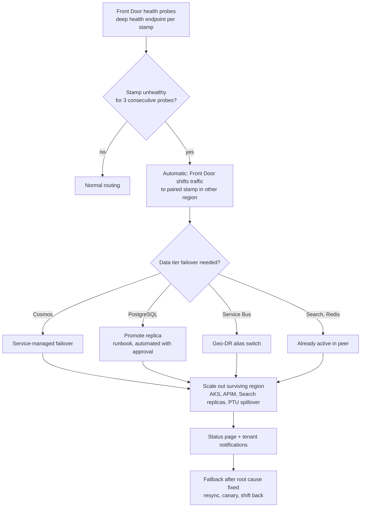

# 17 — Disaster Recovery

## 1. Objectives

| Tier | Scope | RPO | RTO |
|---|---|---|---|
| Tier 0 | Query serving (chat, retrieval, generation) | n/a (stateless) / ≤ 5 min data | ≤ 5 min (active-active) |
| Tier 1 | Conversations, registry, tenant config, ACLs | ≤ 5 min | ≤ 30 min |
| Tier 2 | Search indexes, graph | ≤ 15 min (replicated) / ≤ 24 h (rebuild) | ≤ 30 min (replica promote) / ≤ 24 h (rebuild of a large stamp) |
| Tier 3 | Ingestion pipeline, analytics, Langfuse | ≤ 1 h | ≤ 4 h |
| Tier 4 | Long-term archives | ≤ 24 h | ≤ 72 h |

## 2. Multi-Region Deployment

- Two **active-active** regions serve traffic; each stamp has a **paired stamp** in the other active region holding replicas of its data (for non-residency-pinned tenants).
- Third region **warm**: infrastructure deployed via IaC, minimal node counts, data replicated asynchronously; scale-out runbook < 20 min.
- Residency-pinned tenants: pairs within the same geography (e.g., West Europe ↔ North Europe / Sweden Central).
- Zone redundancy inside every region (AKS, APIM, Redis, Cosmos, PG, AI Search replicas ≥ 3 spread across AZs, ZRS storage) — most failures are handled without regional failover.

## 3. Per-Store Replication & Backup

| Store | Replication | Backup | Recovery |
|---|---|---|---|
| ADLS Gen2 (raw, processed) | GZRS / RA-GZRS; object replication to paired account | Soft delete (30 d), versioning, point-in-time restore for block blobs, immutable audit containers | Account failover / read from secondary; processed zone is the **rebuild source** for indexes |
| Cosmos DB | Multi-region (writes for conversations, single-write + automatic failover for registry) | Continuous backup (PITR 30 d) | Automatic service-managed failover; PITR for logical corruption |
| PostgreSQL Flexible | Zone-redundant HA (sync); cross-region read replica (async) | Automated backups (35 d), geo-redundant backup storage | Promote cross-region replica (RPO seconds–minutes); PITR |
| Azure AI Search | No native cross-region replication → **dual-indexing**: ingestion writes to both regions' services (from the same event stream); 3+ replicas per service in-region | Index definitions in Git; content rebuildable from ADLS processed zone + embeddings Parquet | Fail over to paired service (already in sync); rebuild if both lost |
| Neo4j | Causal cluster in-region; async replica cluster in paired region (or dual-write from ingestion events) | Online backups every 6 h to ADLS | Promote secondary; restore + replay events |
| Managed Redis | Active geo-replication (active-active) | Persistence (AOF/RDB) for memory cluster; caches considered disposable | Surviving region already warm; otherwise **cache warming job** |
| Service Bus | Premium geo-replication (or geo-DR alias) | n/a | Promote secondary; idempotent consumers handle replays |
| Key Vault | Built-in paired-region replication | Soft delete + purge protection | Automatic read-only failover |
| Model deployments | PTU in both active regions; Global/Data Zone deployments | n/a | Model Gateway fallback map |
| Langfuse / ADX | Langfuse PostgreSQL + ClickHouse backups; ADX follower DB in paired region | Daily | Restore / follower promote |

## 4. Cache Recovery

1. Active geo-replication keeps the peer region's caches warm — no cold start in typical failover.
2. If a Redis cluster is lost: services treat the cache as empty (all misses, latency rises to full path), autoscaling absorbs extra load (pre-provisioned headroom 30%).
3. **Warm-up job** replays the top 10k questions per large tenant (from ADX query logs) to repopulate L3, and preloads embeddings of hot chunks into L5.
4. Session/conversation memory rehydrated lazily from Cosmos DB.

## 5. Vector Index Recovery

| Scenario | Procedure | Time |
|---|---|---|
| Replica / partition failure | Automatic within service | minutes |
| Service outage in one region | Search Router flips tenant → paired service (dual-indexed) | < 5 min |
| Index corruption / bad deploy | Swap alias back to previous index version (blue/green retains last version 7 d) | < 5 min |
| Total loss of both copies | Rebuild from ADLS `processed/` chunks + `embeddings/` Parquet (no OCR, no re-embedding): bulk push ~50–100k docs/s per service across partitions | hours (large stamp ≤ 24 h); prioritized by tenant tier |
| Embedding Parquet lost too | Re-embed from chunk text via batch API | + ~11 h at 50k chunks/s for 2B chunks |

## 6. Failover Mechanism

- **Deep health endpoint** checks: API, Redis, AI Search, Cosmos, PG, model gateway; returns degraded vs. unhealthy (degraded keeps traffic but triggers degradation modes in [16 §7](16-scalability-performance.md)).
- Automated traffic failover; **data-tier failovers that risk data loss (PG promote) require on-call approval** unless the outage exceeds 15 min (auto-approve policy).
- Capacity: each active region provisioned to carry ~60% of global peak and autoscale to 100% within 15 min; PTU N+1 planning with PAYG spillover.

## 7. Testing

- Quarterly regional failover game day (per stamp pair) in production with a pilot tenant ring.
- Monthly restore tests: Cosmos PITR, PG PITR, index rebuild of a 10M-chunk tenant from ADLS.
- Chaos Studio continuous experiments in `perf`.
- DR runbooks version-controlled; RTO/RPO measured and reported to compliance.
