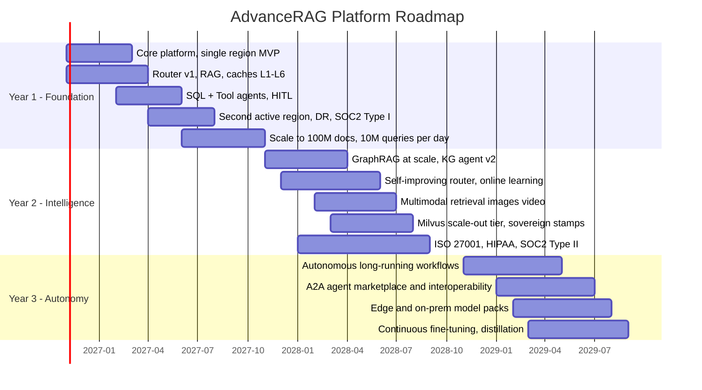

# 21 — Three-Year Roadmap

## Year 1 — Foundation (Production GA)

| Quarter | Deliverables | Exit criteria |
|---|---|---|
| Q1 | Landing zone, stamp IaC, AKS, APIM, Entra, ingestion (PDF/DOCX/PPTX/emails), AI Search hybrid, route A/B, L1/L5 caches, OTel + Langfuse | Internal pilot, P95 < 5 s on 1M docs |
| Q2 | Router v1 (classifier + calibration), L2/L3/L6 caches, Verification Agent, SQL Agent, Tool Agent (MCP), HITL, all file types incl. audio/video/ZIP | 5 pilot tenants, groundedness P50 ≥ 0.9 |
| Q3 | Second active region, DR drills, model gateway multi-provider, cost dashboards, budgets, SOC 2 Type I | 99.95% availability, RTO ≤ 30 min verified |
| Q4 | Scale to 100M docs / 10M queries/day, Planning/Research/Critic agents, L4 global cache, tenant admin console | Targets in [00](00-index.md) met under load test at 1.5× peak |

## Year 2 — Intelligence & Scale

- **GraphRAG at scale:** automated entity resolution, community summaries, graph-augmented retrieval for all tenants.
- **Self-improving routing:** online learning from feedback/HITL, per-tenant router adapters, bandit-based model selection.
- **Multimodal:** image/diagram retrieval with multimodal embeddings, video moment search, chart understanding.
- **Scale-out tier:** Milvus/Zilliz option, learned sparse retrieval, cold-tenant tiering.
- **Sovereign stamps:** in-country deployments, BYOK/HYOK, confidential computing.
- **Compliance:** SOC 2 Type II, ISO 27001 certification, HIPAA BAA program, ISO/IEC 42001 readiness, EU AI Act controls.
- **Agent quality:** agent-level eval suites, automated prompt optimization, trace-driven dataset curation.
- **Proprietary algorithms:** self-optimizing router and model selection (A1, A2, A11), learned fusion and self-healing retrieval (A7, A14), Knowledge Gap Radar and Cost & Quality Simulator (F5, F8) — see [22](22-novel-algorithms-and-features.md); quick wins A3, A5, A8, A9 and Trust Score (F1) land in Year 1 Q3–Q4.

## Year 3 — Autonomy & Ecosystem

- **Autonomous workflows:** long-running, event-triggered agents (e.g., monitor contracts for renewal risk) with approval gates and full audit.
- **Interoperability:** A2A protocol for cross-organization agents; MCP tool marketplace with certification and per-tool governance.
- **Edge / on-prem:** small-model packs (distilled T0/T1) for on-prem and disconnected sites; hybrid retrieval federation across on-prem indexes.
- **Continuous fine-tuning:** distillation of frontier behavior into tenant-specific small models; reduces T2 share to < 5% and cost/query by a further 30–50%.
- **Proactive knowledge:** content-gap detection auto-tasks knowledge managers; answer freshness monitoring.
- **Platform as product:** self-service tenant onboarding, usage-based billing, partner extensions.

## Key Metrics Trajectory

| Metric | End Y1 | End Y2 | End Y3 |
|---|---|---|---|
| Documents | 100M | 500M | 1B+ |
| Daily queries | 10M | 30M | 100M |
| P50 latency | < 2 s | < 1.5 s | < 1 s |
| Answer-cache hit rate | 35% | 45% | 50%+ |
| T2 share of LLM calls | ≤ 10% | ≤ 7% | ≤ 5% |
| Cost per query | ~$0.004 | ~$0.0025 | ~$0.0015 |
| Hallucination KPI | < 1% | < 0.5% | < 0.3% |
| Regions | 2 active + 1 warm | 4 + sovereign | 6+ |
