# 22 — Novel Algorithms & Differentiating Features

This document adds proprietary algorithms and product features on top of the baseline architecture. Each algorithm lists: **problem → idea → math/logic → where it plugs in → expected impact**. Impact figures are design hypotheses to validate with A/B tests.

| # | Algorithm / Feature | Area | Primary gain |
|---|---|---|---|
| A1 | Uncertainty-Decomposed Router (UDR) | Routing | Fewer wrong routes, smarter clarifications |
| A2 | Safe Contextual Bandit Routing (SCBR) | Routing / models | Continuous self-optimization of route + model |
| A3 | Conformal Abstention Guard (CAG) | Hallucination | Guaranteed hallucination rate bound |
| A4 | Slot-Diff Semantic Cache (SDC) | Cache | 2× cache hit rate on near-miss queries |
| A5 | Volatility-Adaptive TTL (VAT) | Cache | Fresher cache with fewer invalidations |
| A6 | Conversational Prefetch Engine (CPE) | Latency | Sub-second follow-ups |
| A7 | Query-Conditioned Fusion (QCF) | Retrieval | Better ranking than fixed RRF |
| A8 | Submodular Context Packing (SCP) | Context | Higher answer quality per token |
| A9 | Claim-Graph Surgical Repair (CGSR) | Verification | Fix hallucinations without full regeneration |
| A10 | Speculative Model Cascade (SMC) | Models | T2 quality at T1 latency/cost |
| A11 | Spend-Pacing Controller (SPC) | Cost | Smooth budget adherence without hard cut-offs |
| A12 | Value-Tiered Enrichment (VTE) | Ingestion | 40–60% lower enrichment cost |
| A13 | Embedding Bridge Migration (EBM) | Index ops | Zero-downtime embedding upgrades |
| A14 | Self-Healing Retrieval Loop (SHRL) | Retrieval quality | Automatic recall repair from failures |
| A15 | Bitemporal Knowledge Graph (BTKG) | Graph | "As-of" and change-over-time answers |
| F1–F8 | Product features | UX / governance | Differentiation |

```mermaid
flowchart LR
    Q["Query"] --> CPE["A6 Prefetch hit?"]
    CPE --> SDC["A4 Slot-Diff Cache<br/>A5 Volatility TTL"]
    SDC -- miss --> UDR["A1 Uncertainty-Decomposed Router"]
    UDR --> SCBR["A2 Safe Bandit<br/>route + model choice"]
    SCBR --> RET["A7 Query-Conditioned Fusion"]
    RET --> SCP["A8 Submodular Packing"]
    SCP --> SMC["A10 Speculative Cascade"]
    SMC --> CGSR["A9 Claim-Graph Repair"]
    CGSR --> CAG["A3 Conformal Abstention"]
    CAG --> OUT["Answer + Trust Score F1"]
    OUT -. feedback .-> SCBR
    OUT -. failures .-> SHRL["A14 Self-Healing Loop"]
    SPC["A11 Spend Pacing"] -. cost weights .-> SCBR
```

---

## A1 — Uncertainty-Decomposed Router (UDR)

**Problem.** A single confidence score cannot distinguish *"the query is ambiguous"* from *"the router has not seen queries like this"*. These need different actions: ask the user vs. plan carefully.

**Idea.** Use a deep ensemble (5 lightweight classifier heads over a shared encoder, or MC-dropout) and decompose predictive uncertainty:

$$
\underbrace{H\big[\bar p\big]}_{\text{total}} = \underbrace{\mathbb{E}_k\, H\big[p_k\big]}_{\text{aleatoric (ambiguity)}} + \underbrace{H\big[\bar p\big] - \mathbb{E}_k\, H\big[p_k\big]}_{\text{epistemic (novelty)}}
$$

where $p_k$ is the route distribution from ensemble member $k$ and $\bar p$ its mean.

**Decision logic (extends [03 §3](03-query-routing.md)):**

| Aleatoric | Epistemic | Action |
|---|---|---|
| Low | Low | Use calibrated confidence thresholds (0.85 / 0.60) as baseline |
| High | Low | **Clarify** — generate 2–3 disambiguation options from the top routes' interpretations |
| Low | High | **Plan** — Planning Agent; log as novel for training-set enrichment |
| High | High | Clarify first; if still uncertain → Planning Agent with strict verification |

**Impact.** Fewer unnecessary planner calls (expensive) and fewer wrong-route answers on ambiguous questions; novelty signal feeds active learning (label only epistemic-high queries → 5–10× labeling efficiency).

---

## A2 — Safe Contextual Bandit Routing (SCBR)

**Problem.** Static thresholds and model-selection weights drift as corpora, models and prices change.

**Idea.** Treat (route, model tier) as **arms** of a contextual bandit; context = query embedding (PCA-64), router features, tenant profile. Use **Linear Thompson Sampling** with a **safety constraint**.

Reward for an executed request:

$$
r = \underbrace{\alpha\, g}_{\text{groundedness}} + \underbrace{\beta\, f}_{\text{user feedback}} - \underbrace{\gamma\, \tfrac{c}{c_{\text{ref}}}}_{\text{cost}} - \underbrace{\eta\, \tfrac{\ell}{\ell_{\text{SLO}}}}_{\text{latency}}
$$

Safety: an arm is eligible only if its lower confidence bound on groundedness satisfies $\text{LCB}_{0.95}(g) \ge 0.80$ for the context cluster. Exploration is limited to ≤ 5% of traffic, never for risk ≥ 0.5, and never for side-effecting routes.

**Plugs in:** after UDR produces candidate routes; also replaces static $w_q,w_c,w_l$ in the model gateway ([10 §3](10-model-strategy.md)) with learned per-cluster preferences. $\gamma$ is driven by A11.

**Impact.** Continuous cost/quality optimization without manual retuning; typical result is migration of 20–30% of T1 traffic to T0 where quality allows.

---

## A3 — Conformal Abstention Guard (CAG)

**Problem.** Groundedness thresholds (0.80) are heuristic; there is no guarantee on how many hallucinated answers slip through.

**Idea.** Use **split conformal risk control**. On a calibration set of $n$ human-labeled answers (from HITL + audits), compute a nonconformity score $s = 1 - \hat g$ (verifier groundedness). Choose threshold $\hat\tau$ so that:

$$
\hat\tau = \text{Quantile}\Big(\{s_i : y_i=\text{correct}\};\ \tfrac{\lceil (n+1)(1-\epsilon)\rceil}{n}\Big)
$$

Serve the answer only if $s \le \hat\tau$; otherwise abstain/repair/escalate. With exchangeability, the probability of serving an unsupported answer is bounded by the target $\epsilon$ (e.g., $\epsilon = 1\%$, matching the hallucination KPI in [14](14-observability.md)).

- Calibrated **per tenant × route × risk band** (Mondrian conformal), recalibrated weekly.
- Drift monitor: if online audit error exceeds $\epsilon$ + margin, tighten $\hat\tau$ automatically.

**Impact.** Turns "low hallucination" into a statistically controlled, auditable guarantee — a strong compliance differentiator.

---

## A4 — Slot-Diff Semantic Cache (SDC)

**Problem.** "What was revenue for **EMEA** in **Q3**?" and "…**APAC** in **Q2**?" are semantically near-identical but must never share an answer; today they are both misses (entity guard blocks them).

**Idea.** Cache **answer templates** with typed slots, not just final answers.

1. On write, extract slots from query and answer: entities, dates, numbers, metric names → template $T$ with slot bindings $S$ and the **execution recipe** (route, SQL template / retrieval filters).
2. On lookup, match the *de-slotted* query vector (cos ≥ 0.95, same `acl_hash`).
3. If only slot values differ: **re-execute the recipe** with new slot values (parameterized SQL, filtered retrieval) and **fill the template** with a T0 model instead of re-planning and regenerating with T1/T2.

$$
\text{latency}_{\text{SDC}} \approx \text{lookup} + \text{recipe exec} + \text{T0 fill} \approx 0.3\text{–}0.6\ \text{s}
$$

**Guards:** recipe must be deterministic (SQL, filtered search); template fill verified by the same verification step; never for E/F/H routes.

**Impact.** Expected +10–20 points effective cache coverage on analytical and per-entity questions; 3–5× faster than full path for these queries.

---

## A5 — Volatility-Adaptive TTL (VAT)

**Problem.** Fixed TTLs (24 h for L3) are too long for fast-changing documents and too short for stable ones.

**Idea.** Model change events of each document as a Poisson process with rate $\lambda_d$ (learned from version history). For an answer citing documents $D$, the probability it is still valid after time $t$:

$$
P_{\text{valid}}(t) = \exp\Big(-t\sum_{d\in D}\lambda_d\Big) \quad\Rightarrow\quad \text{TTL} = \frac{-\ln(1-\delta)}{\sum_{d\in D}\lambda_d}
$$

clipped to [5 min, 7 d], with $\delta$ = acceptable staleness probability (default 2%). Event-driven invalidation ([06 §6](06-cache-architecture.md)) still applies; VAT handles sources without reliable change events (external wikis, polled connectors).

**Impact.** Longer life for stable-policy answers (higher hit rate), shorter for volatile ones (fewer stale answers).

---

## A6 — Conversational Prefetch Engine (CPE)

**Problem.** Follow-up questions are predictable ("…and for last year?", "who approved it?") but pay full latency.

**Idea.** While streaming answer $n$, predict likely follow-ups and **pre-warm** their retrieval and partial context.

- Follow-up predictor: a T0 model + tenant-level **intent transition matrix** $P(i_{n+1} \mid i_n)$ mined from conversation logs.
- For the top-3 predicted follow-ups with $P \ge 0.25$, run retrieval (not generation) and store results in L6 keyed to the session.
- Prefetch budget: ≤ 1 extra search per turn, only when cluster utilization < 70%.

**Impact.** Follow-up P50 drops by the retrieval portion (~250 ms) and context build time; also used to render **suggested next questions** in the UI (F4).

---

## A7 — Query-Conditioned Fusion (QCF)

**Problem.** Fixed RRF ($k=60$, equal weights) is suboptimal: code/ID queries want BM25, conceptual queries want dense, entity queries want graph.

**Idea.** Learn per-query fusion weights $w(q)$ with a small gating model over query features (length, digit ratio, OOV ratio, entity count, IDF stats, language):

$$
\text{score}(d) = \sum_{r \in \{\text{bm25},\,\text{dense},\,\text{sparse},\,\text{graph}\}} \frac{w_r(q)}{k_r + \text{rank}_r(d)}, \qquad w(q) = \text{softmax}(W\phi(q))
$$

Trained with a listwise loss (LambdaRank) on click/citation logs and golden sets. AI Search hybrid queries already accept per-vector `weight`; QCF sets those weights per request.

**Impact.** Expected +3–8% nDCG@10 over fixed RRF; also lets us skip a retriever entirely when its weight < 0.05 (latency/cost saving).

---

## A8 — Submodular Context Packing (SCP)

**Problem.** Top-k by score yields redundant passages and wastes tokens.

**Idea.** Select the evidence set $S$ under token budget $B$ maximizing a monotone submodular utility (relevance + coverage − redundancy):

$$
\max_{S:\ \sum_{c\in S}\text{tok}(c)\le B}\; F(S) = \sum_{c\in S} \text{rel}(c) + \mu \sum_{a \in A(q)} \max_{c\in S} \text{sim}(a,c)
$$

where $A(q)$ are **query aspects** (sub-questions extracted by the router). Solved by **cost-benefit greedy** (pick max $\Delta F / \text{tok}$) and taking the better of the greedy set and the best single item, which guarantees a constant-factor approximation of $\tfrac{1}{2}(1-1/e)$ for knapsack-constrained submodular maximization.

**Impact.** Covers every aspect of multi-part questions; 25–40% fewer evidence tokens at equal or better faithfulness.

---

## A9 — Claim-Graph Surgical Repair (CGSR)

**Problem.** When verification fails, regenerating the whole answer is slow and may introduce new errors.

**Idea.**

1. Decompose the draft into atomic claims; build a **claim dependency graph** (claim B depends on claim A if B references A's entity/number).
2. Verify each claim (NLI vs. cited evidence) → supported / contradicted / unsupported.
3. For failed claims and their **descendants only**: targeted retrieval for that claim → rewrite just those sentences with a constrained-edit prompt (keep other sentences frozen).
4. Re-verify changed claims; if still failing → remove the claim and add an explicit "not found in sources" note.

**Impact.** Repairs in ~300–600 ms instead of 1.5–3 s full regeneration; reduces abstentions while keeping the CAG guarantee (A3) because the repaired answer is re-scored.

---

## A10 — Speculative Model Cascade (SMC)

**Problem.** T2 quality is needed on ~10% of traffic, but T2 latency/cost hurts P95.

**Idea.** Combine cascade with speculative execution:

1. T1 generates the answer while streaming.
2. In parallel, a lightweight **deferral predictor** (logistic model on T1 token log-prob statistics, QPP features, verifier partial scores) estimates $P(\text{T1 insufficient})$.
3. If $P > \theta$ early (first ~60 tokens), start T2 in parallel *with T1's partial draft as a hint*; switch streams if T2 is accepted by the verifier.
4. Otherwise T1 completes; no T2 cost.

$\theta$ is chosen to keep T2 share ≤ 10% (A11 can lower it under budget pressure).

**Impact.** Near-T2 quality on hard queries with ~40% lower T2 invocations vs. post-hoc cascade, and no serial "fail then retry" latency.

---

## A11 — Spend-Pacing Controller (SPC)

**Problem.** Hard budget caps cause abrupt quality drops at month end.

**Idea.** Borrowed from ad-budget pacing: a **PI controller** adjusts the cost weight $\gamma$ (A2) and the SMC threshold $\theta$ (A10) per tenant so that spend tracks a target curve $\hat C(t)$ derived from the monthly budget and the tenant's historical intraday traffic shape:

$$
e(t) = \frac{C(t) - \hat C(t)}{\hat C(t)}, \qquad \gamma(t) = \gamma_0 + K_p\, e(t) + K_i \int_0^t e(\tau)\,d\tau
$$

Clamped so quality floors (minimum tier per task, risk policies) are never violated.

**Impact.** Predictable invoices, graceful quality trade-offs, no "budget cliff".

---

## A12 — Value-Tiered Enrichment (VTE)

**Problem.** Contextual chunk headers, entity extraction, GraphRAG summaries and doc2query are expensive to apply to all 100M documents — most are rarely queried.

**Idea.** Predict a document's **expected query value** at ingestion:

$$
V(d) = P(\text{retrieved in 90 d} \mid \text{doc type, source, folder popularity, author, recency, similarity to hot clusters}) \times \text{business weight}
$$

| Tier | V(d) | Enrichment |
|---|---|---|
| Gold | top 10% | Full: contextual headers, entity/relation extraction, doc2query questions, summaries |
| Silver | next 30% | Contextual headers + entities |
| Bronze | rest | Base chunking + embeddings only |

Documents are **promoted** automatically when they start appearing in retrieval results or abstention gaps (A14).

**Impact.** 40–60% lower ingestion LLM spend with negligible recall loss on actual traffic.

---

## A13 — Embedding Bridge Migration (EBM)

**Problem.** Changing embedding models requires re-embedding ~2B chunks before the new model can be used.

**Idea.** Learn an **orthogonal Procrustes** (or small MLP) mapping from new-model query space to old-model document space using a paired sample (~1M texts embedded with both):

$$
W^* = \arg\min_{W^\top W = I} \lVert X_{\text{new}} W - X_{\text{old}} \rVert_F \;=\; U V^\top,\quad U\Sigma V^\top = \text{SVD}(X_{\text{new}}^\top X_{\text{old}})
$$

During migration, queries are embedded with the new model, mapped via $W^*$ to search the old index; re-embedded shards are queried natively; results are fused. Re-embedding proceeds in the background prioritized by VTE value tiers.

**Impact.** Immediate rollout of better query understanding, no dual full index, migration cost spread over weeks on spot/batch capacity.

---

## A14 — Self-Healing Retrieval Loop (SHRL)

**Problem.** Retrieval failures (abstentions, low rerank scores, thumbs-down) recur until someone manually fixes content or synonyms.

**Idea.** A nightly closed loop:

1. **Mine failures** — cluster failed queries (HDBSCAN on embeddings) per tenant.
2. **Diagnose** each cluster:
   - *Vocabulary gap* (answer exists, BM25/dense miss) → add synonyms to tenant glossary, generate doc2query expansions for the relevant chunks.
   - *Ranking gap* (answer in top-50 but not top-10) → add hard-negative/positive pairs to QCF (A7) training.
   - *Content gap* (no document contains it) → raise to Knowledge Managers (F5).
   - *Routing gap* (answered correctly by another route in fallback) → add to router training.
3. **Validate** the fix by replaying the cluster; deploy only if success rate improves.

**Impact.** Recall improves continuously without manual tuning; measurable reduction in repeat failures week over week.

---

## A15 — Bitemporal Knowledge Graph (BTKG)

**Problem.** Enterprise questions are often temporal ("Who owned the vendor contract **as of March**?", "What changed in the travel policy since last year?"). A current-state graph cannot answer them.

**Idea.** Every node/edge carries **valid time** (`valid_from`, `valid_to` — when it was true in the world) and **transaction time** (`recorded_from`, `recorded_to` — when the platform learned it). Ingestion of a new document version closes old edges instead of deleting them.

- "As-of" queries filter by valid time; audit queries ("what did the system believe on date X") filter by transaction time.
- **Diff operator:** `DIFF(entity, t1, t2)` returns added/removed/changed relationships, feeding "what changed" answers with citations to both versions.

**Impact.** Unlocks change-tracking, compliance and audit use cases competitors' flat RAG cannot answer.

---

## Differentiating Product Features

| # | Feature | Description | Built on |
|---|---|---|---|
| F1 | **Trust Score & Evidence Map** | Each answer shows a calibrated trust score (from CAG) and an interactive map linking every sentence to source passages, SQL, or graph paths | A3, A9 |
| F2 | **Answer Subscriptions** | Users "watch" an answer; when cited documents change and the re-computed answer differs materially (semantic diff > threshold), they get a notification with a highlighted diff | A5, A15, cache dependency index |
| F3 | **Time-Travel Q&A** | "As of" and "what changed since" questions across documents and graph | A15, document versions |
| F4 | **Predictive Suggestions** | Next-question suggestions with pre-warmed results | A6 |
| F5 | **Knowledge Gap Radar** | Tenant dashboard of unanswered topic clusters with volume and business impact; one-click assign to content owners | A14 |
| F6 | **Expert Finder Escalation** | HITL routes to the best human expert using an expertise graph (authorship, past approvals, org chart) instead of a generic queue | Neo4j, Human Review Agent |
| F7 | **Policy-as-Prompt Studio** | Tenant admins define guardrails in natural language; compiled to OPA rules + prompt policies with test cases auto-generated | OPA, Critic Agent |
| F8 | **Cost & Quality Simulator** | Admins preview the effect of changing budgets, model profiles or cache thresholds by replaying last week's traffic offline | A2, A11, Langfuse traces |

## Integration Summary

| Baseline doc | Enhanced by |
|---|---|
| [03 Query routing](03-query-routing.md) | A1, A2 |
| [06 Cache](06-cache-architecture.md) | A4, A5, A6 |
| [07 Ingestion](07-ingestion-pipeline.md) | A12, A13 |
| [08 Retrieval](08-retrieval-architecture.md) | A7, A8, A14 |
| [10 Model strategy](10-model-strategy.md) | A2, A10, A11 |
| [12 Database design](12-database-design.md) | A15 |
| [14 Observability](14-observability.md) | A3 (hallucination KPI guarantee) |
| [18 Cost](18-cost-optimization.md) | A4, A10, A11, A12, A13 |

## Rollout Order

1. **Quick wins (Year 1, Q3–Q4):** A5, A8, A9, A3, F1 — low risk, high quality impact.
2. **Self-optimization (Year 2):** A1, A2, A7, A11, A14, F5, F8.
3. **Advanced (Year 2–3):** A4, A6, A10, A12, A13, A15, F2, F3, F6, F7.

Each algorithm ships behind a per-tenant feature flag, with shadow mode first and an A/B gate on groundedness, latency and cost.
